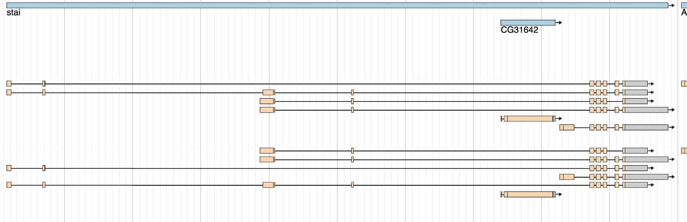
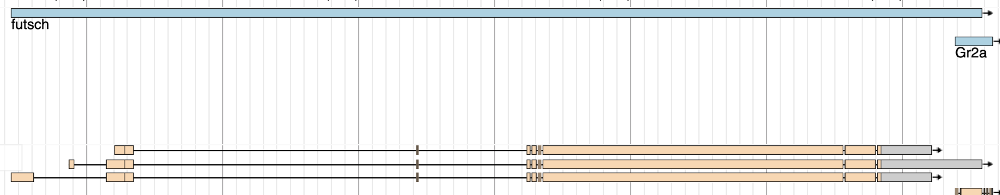
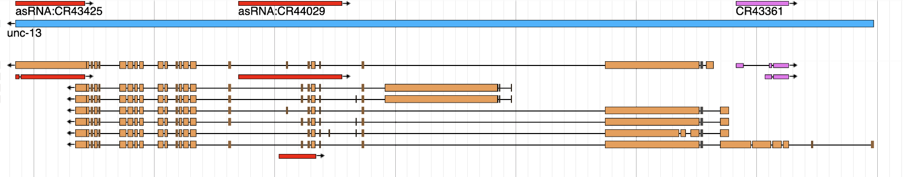
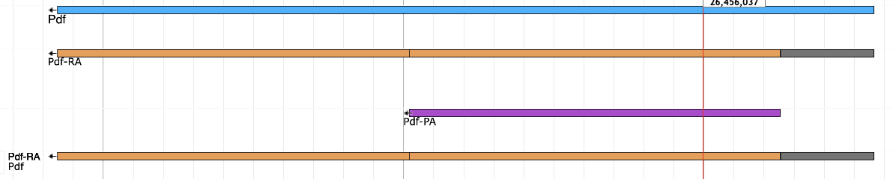

## Introduction

- Feedback session design for the course outline (*L4 Core Skills in MCB outline*, in the instructor's notes; not in this repo): 2 hours, three groups, student-led interactive smFISH data interpretation and experimental design, with general RNA/RBP biology.
- Theme: dysfunctional post-transcriptional regulation (PTR) in humanised TDP-43 ALS *Drosophila* models (see *Teaching genotype*).
- **Part 1:** run simulated smFISH experiments in flies carrying wild-type vs ALS-mutant human TDP-43, interpret how the images differ, and hypothesise which PTR modes are dysfunctional.
- **Part 2:** based on their reading of the microscopy, students design experiments (not limited to microscopy or smFISH) that dissect the mechanism of the TDP-43-linked failure of post-transcriptional regulation further, and propose potential interventions (not a comprehensive treatment programme). It is open-ended. The topics come from the RNA/RBP "Core Skills" companion lecture or from review reading.
- **Design principle: narrow the hypotheses, don't solve the case.** Multiple PTR modes may remain plausible; the unresolved ones seed Part 2. Prediction is lightweight, not the end goal.

### The Biology

**TDP-43 (TARDBP; TBPH in Drosophila)**
- Key RBP dysfunctional in nearly all ALS cases and in many other neurodegenerative diseases (FTD, AD etc.).
- Multifunctional hnRNP regulating many PTR modes, which this session exploits.
- Pathology modes:
	- Nucleo-cytoplasmic shuttling and mis-localisation, including over/under-localisation of TDP-43 or its granules to the periphery (synapses, axons, glial projections).
	- Granule formation and transport defects (viscosity, mobility, content, size, number).
	- Aggregation: loss of normal function (LOF) and toxic gain of function (GOF).
- **Teaching genotype - humanised flies:** fly TBPH knocked out and replaced (knock-in) with human TDP-43, either wild-type (the "control" throughout) or an ALS-linked point mutant (mutation unspecified). Such lines exist.
	- Correct control is humanised WT, not a wild-type fly (a design point for students).
	- Teaches why *Drosophila* is a powerful model for human disease: a human gene can replace its fly orthologue at the endogenous locus.
	- Real basis: [Chang & Morton 2017, *PLoS One*](https://pubmed.ncbi.nlm.nih.gov/28686708/) (hTDP-43 WT, G294A, M337V knock-ins). Reported phenotype is mild (faster age-related climbing decline; no TDP-43 accumulation), so stronger TDP-43 pathology, sleep and memory phenotypes are invented case details.
	- **Membrane label:** motor neuron, Pdf neuron or mushroom body membranes are labelled by a neuron-type-specific GAL4 driver driving UAS-mCD8::BFP.

**ALS and the three Drosophila neuron systems**
- ALS symptoms are not solely motor; students can look up the clinical symptoms in Part 2.
- Each group gets one fly system with an ALS-like **model phenotype that motivates investigation** (not implying each human symptom maps onto one PTR mechanism) and one target gene, unique per group:
	- Motor neuron (adult leg NMJ) - locomotor dysfunction - *stai*
	- Pdf neuron (s-LNv) - sleep and circadian rhythm dysfunction - *futsch*
	- Mushroom body neuron (Kenyon cell) - cognitive and memory impairment - *unc-13*
- Each group works with one system only; cell-type comparisons are not part of the pilot (see *Future implementation ideas*).
- **All adult.** The NMJ is in the adult leg (femur), with the motor neuron cell body in the VNC. Boutons are best studied at larval NMJs but also occur in the less-studied adult leg. The motor neuron is drawn shorter than it really is so the whole cell fits one view (both stated simplifications).
- **Cells shown per animal:** 1 motor neuron; 4 s-LNvs; 30 Kenyon cells (10 per lobe system), all behaving alike.
	- The mushroom body is drawn as one Kenyon cell-body cluster plus shared calyx, peduncle and lobe regions (γ, α′/β′, α/β), not as individual cells, following the compartment-based smFISH analysis of [de Queiroz et al. 2025, *Nat Commun*](https://pmc.ncbi.nlm.nih.gov/articles/PMC11910521/).
	- Only labelled cells are shown (simplification).
- **Representative, not exact anatomy** (simplification): cell bodies and axons are drawn enlarged so RNA molecules and TDP-43 granules are easy to see (see *Geometry references*).

**Post-transcriptional regulation modes**

| Case                                               | Observation                                                                                        | Alternative explanations                                                                       | Useful next evidence                                                                                      |
| -------------------------------------------------- | -------------------------------------------------------------------------------------------------- | ---------------------------------------------------------------------------------------------- | --------------------------------------------------------------------------------------------------------- |
| **Translation / protein output**                   | Similar RNA abundance, less protein                                                                | Protein exocytosis or increased protein turnover                                               | Translation-sensitive reporter or nascent-protein measurement, TRAP/Ribo-seq with appropriate controls    |
| **RNA stability**                                  | Altered mature transcript numbers                                                                  | Reduced production, increased degradation, altered processing                                  | Intron/exon measurements as supporting evidence; a suitable time-course or metabolic-labelling experiment |
| **Splicing / alternative exon / intron retention** | Altered alternative-exon : constitutive-exon spot ratio; intron signal outside transcription sites | Changed exon inclusion; isoform-specific decay; altered TSS/3'PAS use                          | Isoform- or junction-specific probes; RT-PCR of splice isoforms                                           |
| **RNA localisation / transport**                   | Similar whole-cell count, fewer spots in axon/synapse                                              | Transport defect; local degradation; altered anchoring; changed axon/bouton morphology         | Compartment-normalised counts; live mRNA imaging (e.g. MS2) for transport dynamics                        |
| **Nuclear export / retention**                     | Higher nuclear : cytoplasmic ratio of mature (exon) spots                                          | Export block; retention via intron retention; increased transcription                          | Intron vs exon probes to separate nascent from mature RNA; transcription-site intensity                   |
| **Isoform-specific regulation**                    | Fewer long-isoform spots in axons                                                                  | Less long isoform produced; altered localisation; local degradation; changed axonal morphology | Whole-cell isoform abundance, compartment-normalised measurements, then a dynamic assay if needed         |
| **Granule incorporation**                          | Target mRNA co-localises more (or less) with TDP-43 puncta                                         | Increased granule recruitment; granule immobilisation; chance overlap at high density          | Co-localisation vs randomised-position control; granule mobility (live imaging/FRAP)                      |
| **Cell-type-specific regulation**                  | Same target changes in one neuron type but not another                                             | Different TDP-43 pathology level; cell-type isoform expression; different co-regulators        | Compare TDP-43 IF and target per cell type; cell-type-specific rescue                                     |

- Modes need not be competing: students distinguish **co-occurring modes** (both true) from **alternative explanations** (one observation, several possible causes, not yet separable).
- **Pilot scope:** translation (no target protein readout) and cell-type-specific regulation (one system per group) are not tested; students may still raise them as hypotheses or in Part 2.

**Potential TDP-43 target RNAs**

- Splicing cases use **annotated alternative exons** (checkable on FlyBase) rather than invented cryptic exons, so students can connect the simulation to real splicing literature (e.g. human STMN2/UNC13A).
- **Literature is encouraged but neutral:** it supplies background and hypotheses, never the case answer, and cases avoid contradicting it outright. Hence futsch is not used at the NMJ, where Coyne et al. 2014 already reports the result.
- All three targets encode cytoskeletal or synaptic proteins, so their mRNAs plausibly occur in the cell body, axon and synapse (unlike transcription factors, which would be hard to justify at synapses).
- **[stai](https://flybase.org/search/stai) (STMN2) → NMJ**: tubulin-binding protein in axo-dendritic transport and NMJ synaptic growth; human STMN2 splicing is affected by TDP-43 dysfunction. stai mutants lose NMJ stability (Graf et al. 2011).
	- Intron, alternative exons, TSS, 3'PAS 
	- FlyBase isoforms stai-RA–RE: 3 TSSs (RC/RE; RA/RB; RD), a cassette exon skipped only in RA, and a long 3'UTR in RB and RD.
	- The same-strand gene CG31642 is nested in a stai intron, so intron probes placed there also detect CG31642 mRNA (probe-design trap).
- **[futsch](https://flybase.org/search/futsch) (MAP1B) → Pdf neurons**: microtubule-binding protein for synaptic bouton formation at the NMJ; expression regulated by [TBPH](https://flybase.org/search/TBPH). In Pdf neurons: microtubules in the s-LNv dorsal terminals, which remodel daily (Fernández et al. 2008).
	- Introns, 3 alternative TSSs/first exons, alternative 3'PAS (short vs long 3'UTR) 
	- FlyBase isoforms futsch-RC, -RE and -RF encode the same protein and differ only in TSS and 3' end. Only RE has the long 3'UTR, whose distal part overlaps Gr2a on the same strand.
	- NMJ literature is background only: TDP-43 overexpression shifts futsch mRNA from the NMJ to cell bodies and out of polysomes (Coyne et al. 2014); TBPH loss lowers Futsch protein via a UG-rich 5'UTR element (Romano et al. 2016).
- **[unc-13](https://flybase.org/search/unc-13) (UNC13A) → mushroom body**: synaptic vesicle exocytosis; Kenyon cell output is needed for memory.
	- Intron, alternative exons, TSS, 3'PAS 
	- FlyBase isoforms unc-13-RA–RG fall into two N-terminal groups: group 1 (RA, RC, RD, RF, RG) and group 2 (RB, RE). The group-2 start site lies inside a group-1 intron (nested promoter). RD alone has a long 3'UTR; RG has a far-upstream start site. Overlapping antisense RNAs are on the opposite strand, so they don't affect strand-specific smFISH.
- **[Pdf](https://flybase.org/search/Pdf) - not used** (pigment-dispersing factor; neuropeptide acting via a GPCR; key role in circadian rhythms): no introns or isoforms, so it cannot reward dual-channel probe design. 
- Exact FlyBase models and the curated probe menus: see *Transcript models and probe menus* (Implementation spec).

### Simulations

**Three layers** (they classify every claim in this spec and the instructor key; the student screens carry no per-claim layer badges; the dashed "Simulated" pill stands in for the *Invented for this case* badge):
- Established biology: TDP-43 and RNA regulation.
- Simplified assumptions: how this teaching model behaves.
- Invented case details: particular target - cell-type - behaviour relationships.

**Channels:** membrane (GAL4 > mCD8::BFP) + DAPI in one fixed blue channel, told apart by shape; smFISH 1 and 2, TDP-43 IF (technical details in *Viewer features*).
- **TDP-43 IF (simulated)** is first shown alone as a clue (control vs mutant) before probe selection, then kept as a toggle. Needed for granule incorporation and target–TDP-43 co-localisation.
	- Phenotype differs by neuron system (invented), giving each group a different handle (see *Case truth tables*).
	- **Must not give the answer away:** point to several modes at once, e.g. nuclear depletion (LOF → splicing/export) *and* cytoplasmic aggregates (GOF → sequestration). In the Pdf case the clue has four parts: nuclear and diffuse cytoplasmic loss (→ splicing/export and stability/translation/transport), aggregates (→ sequestration/GOF), and transport granules that are equal in both genotypes.

**Multiple plausible PTR modes per system**
- Students may conclude "we cannot distinguish these explanations yet"; this rewards challenge and guides Part 2.
- **Constrain the ambiguity** (not "anything goes"). Per case the data should rule out at least one mode, support one or two, and leave one explicitly unresolved (→ Part 2 *Uncertainty*).
- **Designed, not accidental:** uncertainty should come from the biology, not from confusing images or uninformative probes.
- **Same observation, different potential PTR modes:** with the constitutive probe alone, every case shows fewer mutant target spots at synapses. The second probe narrows the modes, with a different leading mode per case, so dual-channel design is rewarded and the plenary compares one observation with three explanations.
- **Coverage:** each mode is supported or unresolved in at least one case and ruled out in another, so no mode is "always right".
- **Student-facing text:** same template for every case (behaviour, target function, full FlyBase map, TDP-43 IF); no PTR-mode names in case text (they appear only on the generic step 4 mode cards); no highlighted "relevant" exon; unused TSSs and exons stay on the map as decoys.
- Instructor answer key: the case truth tables (below).

**Case truth tables (instructor answer key)**

Shared across cases:
- **One probe** (constitutive reference S7, F6 or U7): fewer mutant target spots at synapses. Other single probes differ by design (e.g. S1 bouton counts are unchanged; U4 lobe counts rise; intron probes show no synaptic spots).
- **TDP-43 IF clue:** nuclear depletion *and* cytoplasmic puncta (granules, aggregates or both) in every case, so LOF and GOF both stay open.
- **Three stories:** RNA redistributed (NMJ), lost (Pdf), or the wrong isoform (mushroom body).
- **Numbers:** see *Simulation parameters*.

*NMJ – stai: RNA stuck on the way*
- **TDP-43 clue:** mild nuclear loss; puncta along the axon and in boutons.
- **One probe:** fewer bouton spots; whole-cell count unchanged.
- **Informative pair:** S7 (last exon) + S8 (long 3'UTR). The missing bouton molecules are the long-3'UTR isoforms (stai-RB, -RD), which sit on TDP-43 puncta in the axon. The long:short ratio in the cell body is unchanged, so "less long isoform made" is ruled out.
- **Supported:** isoform-specific transport; granule incorporation.
- **Ruled out:** splicing (the STMN2 prior: S1, S2, S4 and S6 give a clean null, and starting a new pair lets the group recover); nuclear export; stability (whole-cell count unchanged).
- **Unresolved → Part 2:** an RNA-specific stall in TDP-43 granules, or general failure of microtubule transport (stathmin itself regulates microtubules, so the defect could feed itself).
- **Confound and trap:** S3 also detects CG31642 mRNA, which looks like intron retention but is equal in both genotypes.
- **Bouton number (instructor only; outside the students' scope):** the mutant has fewer boutons (20 → 15), visible in the images but never measured. Bouton spots are set as a compartment total, so the fall holds per bouton too (3.0 → 1.9).

*Pdf neurons – futsch: RNA made but not kept*
- **TDP-43 clue:** nuclear loss, less diffuse cytoplasmic signal, and irregular aggregates around the nucleus. Small round transport granules are equal in both genotypes.
- **One probe:** fewer spots in the cell body, axon and terminals, while the nuclear count stays flat, so the nuclear:cytoplasmic ratio doubles. This looks like RNA held back in the nucleus.
- **Informative pair:** F6 (exon) + F5 (13-kb intron). Transcription sites are unchanged, so production looks normal; there are no intron-positive spots away from transcription sites; the share of cytoplasmic RNA reaching terminals is normal.
- **Supported:** stability (faster decay).
- **Ruled out:** an export block that leaves RNA in the nucleus (nuclear counts are flat); transport; isoform-specific regulation (F1, F3, F4 and F8 ratios unchanged); splicing and intron retention; granule incorporation (futsch is a granule cargo, but the share of spots on transport granules is above chance and the same in both genotypes in the axon and terminals, at chance in the cell body, and aggregates don't trap it).
- **Unresolved → Part 2:** is the RNA lost in the cytoplasm, or never exported and degraded in the nucleus? Nuclear decay is fast, so neither leaves RNA behind in a snapshot.
- **Instructor key (never stated to students):** *Invented for this case*: the soluble cytoplasmic TDP-43 keeps futsch mRNA stable, so its loss (0.16 → 0.08 of the control nuclear level) is why futsch falls in the mutant. The TDP-43 the mutant lost from the nucleus and cell-body cytoplasm is drawn into the aggregates (*Simplified*). In a maximum-intensity projection brightness shows concentration, not amount, and aggregates are dense, so a few small ones can hold it. Total cytoplasmic TDP-43 (diffuse + aggregates) rises while the soluble pool falls.
- **Caveat worth raising:** transcription-site brightness is only a stand-in for production; with 12 nuclei per genotype it is usable.
- **Sampling time:** ZT2, when s-LNv dorsal terminals are most branched (they remodel daily; Fernández et al. 2008).
- **Confound (instructor only; outside the students' scope):** mutant terminals are slightly less branched, but spots per terminal area are still lower after normalising. The site does not plot per-area counts; the truth table still checks the fall per area.

*Mushroom body – unc-13: the wrong isoform*
- **TDP-43 clue:** nuclear loss in Kenyon cells; many small puncta across the dense neuropil.
- **One probe:** fewer spots in the lobes; whole-cell count unchanged; spots seem to overlap TDP-43 puncta.
- **Informative pair:** U2 + U4 (group 1: unc-13-RA/RC/RD/RF/RG; group 2: unc-13-RB/RE). Across the cell the group-1:group-2 ratio shifts towards group 2; lobe spots are group 1 in both genotypes, and the share of group 1 reaching the lobes is unchanged.
- **Supported:** isoform-specific regulation (first-exon switch).
- **Ruled out:** transport; granule incorporation (overlap matches randomised positions); nuclear export.
- **Unresolved → Part 2:** with U2 + U4 alone, a start-site switch (production) or faster decay of group 1 (stability). U3 (group-1-only nascent RNA) shows that group-1 production falls, but the group-2 rise could be more production or more stability, because group 2 has no intron of its own. A first-exon change also sits on the boundary between splicing and transcription, while the human UNC13A prior says "splicing".

**Coverage** (✓ supported, ✗ ruled out, ? unresolved, ~ ambiguous)

| Mode | NMJ – stai | Pdf – futsch | Mushroom body – unc-13 |
| --- | --- | --- | --- |
| Transport / localisation | ✓ | ✗ | ✗ |
| Granule incorporation | ✓ | ✗ (same share on granules) | ✗ (chance overlap) |
| Isoform-specific | ✓ | ✗ | ✓ |
| Splicing / intron retention | ✗ | ✗ | ~ (first exon) |
| Nuclear export / retention | ✗ | ? (failed export + nuclear decay) | ✗ |
| Stability | ✗ | ✓ | ? (group 2) |
| Translation | not tested | not tested | not tested |

---
## Part 1

### A possible sequence

1. **Phenotype (engagement):** hero (knock-in sequence, two identical humanised flies), then a shared three-assay landing; each group picks one of three systems → individual pages (see *Openings*). Animate the fly *and* its behavioural assay (NMJ: a climbing defect, with shaking shown as part of the climbing animation; Pdf neurons: activity/sleep trace; mushroom body: learning/memory test); students may draw on them in Part 2.
2. **Anatomy:** semi-transparent fruit fly with appropriate neurons highlighted; a scroll-driven descent that ends in the viewer (see *Openings*) (same blue colour scheme as neuronal membrane in the microscopy images). For the NMJ, zoom into the leg femur (synapses) and the VNC (motor neuron cell body).
3. **TDP-43 dysfunction (the first clue):** the descent lands in the viewer on TDP-43 IF in control vs mutant. Qualitative, by eye only. Record observation separately from interpretation (early practice).
4. **Hypotheses:** shortlist PTR modes consistent with the clue (need not be competing). The target gene is not yet known, so gene information cannot steer the hypotheses.
5. **Target & probe design:** introduction of the TDP-43 target (function, orthologues, FlyBase link-out) above its transcript map (introns, annotated alternative exons, TSS, 3'PAS), with the probe track shown on the same map. Select two probe regions; optionally note, per shortlisted mode, what it would look like with these probes. Results open as soon as two regions are chosen. Groups can start a new pair at any time, as often as they like: exploration is never penalised (see *Target & probe design (step 5)*).
6. **Microscopy reveal** (one screen): control and mutant smFISH, 3 animals, count plot; TDP-43 channel remains toggle-able. Alongside, record observation vs interpretation and classify each shortlisted mode as *ruled out / supported / unresolved* (see *Microscopy reveal (step 6)*).
7. **Interpret & revise** the explanation → gives the *Claim* and *Uncertainty*, the starting point for Part 2. No follow-up experiments on the website: students design them in Part 2 (instructor notes: *Example Part 2 directions*; screen: *Interpret & revise (step 7)*).

### Implementation spec

#### Repository layout

Paths in this document are relative to `docs/` unless stated otherwise.

| Path | Contents |
| --- | --- |
| `docs/spec.md` | This spec |
| `docs/style-directions/` | Style-phase mockups, screenshots, review note; `tokens.css` (frozen design tokens) |
| `docs/mockups/` | Transcript map mockup (`step5-target-probe-map.html`) and screenshots |
| `docs/storyboards/` | Opening storyboards for review before animation code (`pdf-openings.md`) and fly-drawing contact sheets |
| `docs/references/` | `reference-pdf-neurons.pdf` (+ `.docx`), `dam-motion/` (activity-monitor schematic), `gene-models/` (FlyBase gene-model images) |
| `docs/transcript_models_R6.json` | Transcript models, CDS and probe menus; source for the generator and the map. Probe IDs follow the menus in this spec |
| `pyproject.toml`, `uv.lock`, `.python-version` (root) | Python environment for the generator and build scripts, managed with uv |
| `site/` (root) | The static site served by GitHub Pages: `index.html`, `css/` (`tokens.css` copied in from `docs/style-directions/`), `js/`, `fonts/`, `vendor/` (pinned PixiJS 8.22.0, `pixi-viewport` 6.0.3, GSAP 3.15.0) and `data/<case>/` (public data only: transcript maps without the answer key, geometry, pre-computed tables, molecule positions and masks, and `images/` with the rendered membrane, DAPI and TDP-43 nuclear images), `data/flies/` (fly drawing sprites) and `textures/` (paper and wash images for the story layer). Story-layer scripts: `js/fly.js` (fly sprites and the ink boil), `js/gsap.js` (loads the pinned GSAP), `js/monitor.js` (the activity monitor's tubes, fly motion and seeded activity model), `js/stations.js` (the three landing stations), `js/brain.js` (the frontal brain schematic for the descent) and `js/handoff.js` (shared elements across a route change) |
| `generator/` (root) | Python scripts, run with uv as `uv run python -m generator.<script>`: `public_models`, `geometry_pdf`, `truth_table`, `build` (generator and tables), `validate` (the gate) and `flies` (fly drawings from flybody, written to `site/data/flies/`) |
| `data/<case>/` (root) | Never served: the truth table (`truth-table.toml`, the rules the instructor signs off; `truth-table.json` and `.md`, expanded from it) and full molecule records (`generated/`, rebuilt by the generator and not committed) |
| `tools/` (root) | `serve.py` (local server without caching), `contact-sheet.sh` and `frozen-time.sh` (animation review loop) and `review-shots.sh` (screenshots of every step in both themes and at both sizes) |
| `.github/workflows/pages.yml` | Deploys `site/` to GitHub Pages after checking that the generated data is up to date and the validation gate passes |

Mockups and screenshots in `docs/` are design records and are not served.

#### Purpose and scope

Static site for designing two-colour smFISH experiments on TDP-43 target mRNAs and exploring simulated images of Drosophila neurons. All images and numbers are labelled as simulated teaching data.

- **In scope:** three adult cases (leg motor neuron NMJ – *stai*, Pdf neurons – *futsch*, mushroom body – *unc-13*), animated phenotype/assay introduction, probe placement on real FlyBase transcript maps, TDP-43 IF channel, configurable LUTs, zoomable viewer, count tables and plots supplied with the simulated data, lab notebook, PNG export.
- **Out of scope:** real image data, probe thermodynamics and length limits (any annotated region can be a probe region), chromatic offset, user accounts, server-side storage, follow-up experiments, target protein output, glia and cell-type comparisons (see *Future implementation ideas*), unlabelled neighbouring cells.

#### Build phases

Build one case completely before the others, so every shared part (data pipeline, viewer, map, plot, notebook, openings) is proven and assessed once, then reused.

**Phase 0 – Style direction (done).** Direction A with C's compare pane, subtle texture, dark `#1F1E1C`, revised text sizes; frozen in `style-directions/tokens.css` (see [Style directions review](style-directions/Style%20directions%20review.md)).

**Phase 1 – Pdf neurons (*futsch*), start to finish.** Every step from the hero to the summary PNG, working for this one case.
- *Why Pdf first:* it has the least connectome support (geometry traced from reference images), the widest range of intron sizes on its map (13 kb vs 63 nt), a daily-remodelling terminal arbor at ZT2, and four cells per animal, so it tests the hardest parts of geometry, map and plot early.
- *Order of work:*
	1. **Scaffold:** repository (the uv environment is already set up), `tokens.css`, self-hosted fonts and libraries, hash routes, progress rail, notebook shell, light/dark theme, GitHub Pages and offline test.
	2. **Data:** Pdf geometry (control and mutant templates), the Pdf truth table as a machine-readable file (signed off by the instructor), generator, detection masks, pre-computed tables (incl. per-animal and per-unit values), public JSON stripping, and the validation gate against the Pdf truth table.
	3. **Screens 3–7:** viewer (split view, flicker, fly-to, LUTs incl. TDP-43 dimming, overlay, PNG copy), TDP-43 dysfunction, hypotheses cards, gene card and map with probe track, microscopy reveal with plot, interpret & revise with summary PNG.
	4. **Openings:** hero and knock-in sequence; three-assay landing with the activity monitor live (climbing vial and T-maze shown as still placeholders); the Pdf descent ending in the viewer.
	5. **Review loop:** Playwright recordings, contact sheets and dead-stretch checks for the animations; screenshots of every step at 1280×720 and 1920×1080 in both themes (`tools/review-shots.sh`). Each run is recorded in [review.md](review.md).
- *Exit: manual assessment* (instructor, ideally with one or two colleagues or students who haven't seen the spec):
	- **Science:** the Pdf truth table is reproduced, e.g. F6 + F5 shows flat transcription sites and fewer cytoplasmic spots; each decoy gives its designed result; no step gives the answer away.
	- **Usability:** a FISH-naive first-time user gets from the hero to the summary PNG without help; the decoder legend and "How two-colour smFISH works" are enough to read the images.
	- **Design:** banned list, contrast in both themes, text-size rule, colour belongs to the data, texture stops at the data.
	- **Motion:** under 40 s of directed animation; reduced motion gives still end frames.
	- **Devices:** Chrome, Edge, Firefox and Safari; 1280×720 minimum; a low-end Windows laptop with integrated graphics; offline copy.
	- **Open questions to settle before Phase 2:** keeping verdicts across probe pairs, the TDP-43 default colour, and the default zoom when results open.
- Findings are written back into this spec before Phase 2 starts.

**Phase 2 – The rest.** The NMJ (*stai*) and mushroom body (*unc-13*) cases, reusing everything from Phase 1.
- **Per case:** geometry (connectome-assisted: MANC for the motor neuron, FlyWire/MaleCNS for Kenyon cells), simulation parameters, truth table and validation gate, gene card and map, assay animation (climbing with shaking; T-maze), and descent path.
- **Shared:** the NMJ and mushroom body cases reuse the same four-class TDP-43 layer (diffuse nuclear, diffuse cytoplasmic, transport granules, aggregates). The NMJ's extra mutant puncta along the axon and in boutons are stalled transport granules carrying cargo, not aggregates, which keeps the cases' stories distinct.
- **Shared:** all three landing stations live; cross-case check that the student-facing template is identical and the *Coverage* table holds across the three cases.
- **Pilot readiness:** full review loop for all three cases; deploy to GitHub Pages and test the offline copy; a dry run of the 2-hour session with colleagues; instructor answer key (truth tables, example Part 2 directions) as a separate document.

#### Architecture

Data generation is separate from display, so images and numbers always agree. A generator script creates every molecule once from a fixed seed and pre-computes every probe result; the website only reads and draws that data.

0. **Case truth table** (see *Case truth tables*): per case, which PTR modes are active, plus the expected result for every single probe and every probe pair, decoys included. Active modes combine into one coherent molecule set. The generator implements it; instructors use it as the answer key.
	- Stored per case in `data/<case>/`: `truth-table.toml` holds the rules (verdicts, isoform mix, counts per compartment, how each measure changes in the mutant, tolerances, the designed transcription-site look of each region); `generator.truth_table` expands it with the probe menu's `mature_in` / `nascent_in` into `truth-table.json`, covering every single probe and all 56 ordered pairs, and `truth-table.md` to read. It is drafted from the prose tables in *Case truth tables* and signed off by the instructor (in the `.toml`) before the validation gate relies on it. The Pdf table was amended on 2026-10-07 (TDP-43 layer and per-compartment overlap), and the instructor signed off the amended table on the same day.
0.5. **Geometry** (built before the generator; see *Geometry references*): one file per case, genotype and animal, in µm, shared by generator and viewer, so it lives in `site/data/<case>/geometry-<genotype>-<animal>.json` (Pdf: written by `generator.geometry_pdf`). All animals of a case share one image frame.
	- Closed, non-overlapping named shapes: nucleus, cell body cytoplasm, dendrites, axon (with centreline), each bouton or terminal. Mushroom body: one cell-body cluster (30 nuclei), calyx, peduncle and the three lobe systems as shared regions.
	- Minimum neurite width 0.5 µm, so spots fit inside; axons wider (see *Geometry references*).
	- Every animal has its own neurons: cell arrangement and sizes, axon path, weaving and branching vary from animal to animal, while the genotype difference stays systematic (NMJ: 20 vs 15 boutons, for the images only; Pdf: s-LNv dorsal terminals at ZT2, each mutant arbor about 20% shorter than the control mean).
	- Key coordinates (nucleus centres and radii, terminal area and length) and fly-to views stored in the same file.
1. **Generator** (Python with NumPy and Shapely, run with uv: `generator.build`): produces one JSON file per case, genotype and animal. Which regions a molecule carries is worked out from exon coordinates (mature RNA) and from the polymerase position along the pre-mRNA (nascent RNA: a region counts once the polymerase has passed its midpoint), not from the hand-written `mature_in` / `nascent_in` lists, so the gate also checks the menu annotations. Counts are Poisson draws, so a given set of three animals may not reproduce the truth table. The build draws a pool of candidate animals (120) for each of the six slots (genotype × animal 1–3), each from its own seed, and chooses the combination that passes every check and matches most closely, like choosing representative animals from a larger set. Every animal shown is a genuine draw; the choice is deterministic, so the same inputs always give the same animals and files. Each molecule records its gene (the target, or an overlapping same-strand gene such as CG31642), isoform, the transcript regions it carries (nascent and intron-retained molecules include intron regions), position in µm inside its geometry compartment, compartment, and whether it is nascent or in a granule. A TDP-43 protein layer (diffuse nuclear and cytoplasmic intensity fields, transport granule positions and aggregate outlines) is generated from the same seed so target mRNA–TDP-43 co-localisation is consistent.
2. **Detection** (pre-computed by the generator): for each molecule and each of the 8 probe regions, whether it is detected, stored as an 8-bit mask per molecule. **Pilot: detection efficiency is 1.0**, so a molecule is detected by a region if and only if it carries it (not introduced to students; see *Future implementation ideas*). The browser only filters by this mask.
3. **Viewer**: draws anatomy, spots and background.
4. **Tables and summary** (pre-computed): for each single probe and all 56 ordered probe assignments per case (28 pairs × channel order, so a channel swap only swaps columns). Per compartment and channel: single- and double-positive counts; nuclear:cytoplasmic ratio; share of cytoplasmic RNA in axon and terminals; counts per terminal unit (per bouton at the NMJ; per terminal area for Pdf neurons; per lobe system for the mushroom body; computed for the answer key, not plotted for students); transcription-site number and intensity; overlap with TDP-43 transport granules per compartment vs a randomised-position control. Mean ± SD over 3 animals, plus the per-animal means and per-unit values the count plot needs (see *Count plot*).
5. **Validation** (build gate, `generator.validate`): compares every pre-computed result with the truth table's expected results; any mismatch fails the build. Where counts are small, a band is widened by two standard errors of counting noise, so "unchanged" means no difference beyond what the counts can resolve, and never more than the stated tolerance where they can. It runs in the Pages workflow; with `--signed` it also fails until the instructor has signed off the truth table.
	- *Measures* (`generator/tables.py`): counts in the nucleus and cell body are per cell (mean of the cells), in shared compartments (axon and terminals at the Pdf neurons) per animal; the nuclear count excludes the transcription site, which is reported separately (number of nuclei with a site of at least 2 nascent molecules, and mean molecules per site); N:C is nucleus / cell body; the distal share is (axon + terminals) / all cytoplasmic RNA; TDP-43 overlap is, per compartment (cell body, axon, dorsal terminals), the share of mature spots within 0.3 µm of a transport granule's edge (aggregates are not counted), against the randomised-position level (the expected share for uniform positions in the same compartment, computed from areas). The Pdf truth table expects the cell body at chance in both genotypes, and the axon and terminals at least 10 percentage points above chance (less 2 SE; tolerance `above = 0.10`), with the mutant's share within ±5% of control's (or 2 SE of counting noise).

Molecules do not depend on probe choice, so every group, and every new attempt, gets the same result for the same choice.

#### Transcript models and probe menus

- Maps show every annotated isoform with its FlyBase name, drawn from Release 6 coordinates (NCBI RefSeq, FlyBase-derived; pin the FlyBase release at build). Full exon models, CDS, overlapping same-strand genes and the menus below are in `transcript_models_R6.json` (in `docs/`, alongside this file).
- Students choose two regions from a curated menu of 8 per gene, including decoys. On screen, regions carry neutral IDs (S1–S8 etc.), numbered 5′→3′ from left to right on the map; the note column is instructor-only.
- *Mature in*: isoforms whose mRNA contains the region. *Nascent in*: isoforms whose pre-mRNA spans it. They differ for nested promoters.
- Gr2a CDS added from NCBI RefSeq (FlyBase-derived; Gr2a-PB 410 aa, Gr2a-PC 428 aa), so it draws as coding.
- How the map looks and behaves on screen: see *Steps 5–7*.

**stai** (+ strand, 2L)

| ID | Region (R6) | Type | Mature in | Nascent in | Note |
| --- | --- | --- | --- | --- | --- |
| S1 | 6,100,377–6,100,549 | first exon (TSS1) | RC, RE | RC, RE | start-site decoy |
| S2 | 6,109,667–6,109,772 | first exon (TSS2) | RA, RB | RA, RB, RC, RE | start-site decoy (nested) |
| S3 | 6,118,512–6,120,522 | intron | CG31642 mRNA | RA, RB, RC, RE | same-strand gene trap |
| S4 | 6,120,674–6,121,210 | first exon (TSS3) | RD | all | start-site decoy (nested) |
| S5 | 6,122,411–6,122,697 | intron | – | all | transcription sites |
| S6 | 6,122,698–6,122,853 | cassette exon | all but RA | all | splicing decoy |
| S7 | 6,122,978–6,123,899 | last exon | all | all | constitutive reference |
| S8 | 6,123,900–6,124,653 | long 3'UTR | RB, RD | RB, RD | long-3'UTR isoforms |

**futsch** (+ strand, X)

| ID | Region (R6) | Type | Mature in | Nascent in | Note |
| --- | --- | --- | --- | --- | --- |
| F1 | 1,409,069–1,410,121 | first exon (TSS1) | RF | RF | start-site decoy |
| F2 | 1,410,122–1,411,725 | intron | – | RF | RF-only nascent RNA |
| F3 | 1,411,726–1,411,978 | first exon (TSS2) | RE | RE, RF | start-site decoy (nested) |
| F4 | 1,413,418–1,413,800 | 5'UTR exon | RE, RF | RE, RF | absent from RC |
| F5 | 1,414,686–1,427,675 | intron (13 kb) | – | all | bright transcription sites |
| F6 | 1,433,476–1,447,295 | giant coding exon | all | all | constitutive reference |
| F7 | 1,448,784–1,448,846 | intron (63 nt) | – | all | 3' intron: dim transcription sites |
| F8 | 1,451,368–1,452,429 | long 3'UTR (proximal) | RE | RE | long-3'UTR isoform; stops short of Gr2a |

**unc-13** (− strand, 4; group 1 = RA, RC, RD, RF, RG; group 2 = RB, RE)

| ID | Region (R6) | Type | Mature in | Nascent in | Note |
| --- | --- | --- | --- | --- | --- |
| U1 | 904,822–905,963 | first exon (far upstream) | RG | RG | start-site decoy |
| U2 | 898,393–902,234 | N-terminal exon | group 1 | group 1 | isoform group 1 |
| U3 | 893,566–898,392 | intron | – | group 1 | group-1-only nascent RNA |
| U4 | 886,965–892,840 | N-terminal exon | group 2 | all | isoform group 2 (intronic in group 1) |
| U5 | 881,843–881,949 | alternative exon | RA, RD | all | splicing decoy |
| U6 | 878,993–881,842 | intron | – | all | transcription sites (both promoter groups) |
| U7 | 870,930–871,654 | last exon | all | all | constitutive reference |
| U8 | 867,824–870,929 | long 3'UTR | RD | RD | 3'-end decoy |

#### Geometry references

**Aim:** a representative simulated neuron, not an exact replica of the anatomy. Shapes need roughly the right proportions for the neuron type, and the viewport should look like a realistic confocal image, not an anatomy-book drawing. What matters is that students can see where RNA sits: transcription foci in the nucleus, cell body cytoplasm, axon and terminals.
- **Enlarged for visibility:** cell bodies are drawn large so cytoplasmic spots are easy to see and count. Axons are wide enough to show RNA molecules in transport and TDP-43 granules side by side. Starting values, to tune after the pilot: cell body about 15 µm across (real s-LNv about 6–8 µm), nucleus about 7 µm, axon at least 2 µm wide.
- **Membrane channel look:** a filled-in cytoplasm is fine, as long as it is a dim, desaturated blue that doesn't compete with the smFISH spots.

An AI agent (antigravity-gemini or Opus) builds the geometry files from three inputs per system. Tracing reference images is fine where connectome data lack the cells needed:

| Input | Purpose | Sources |
| --- | --- | --- |
| Connectome skeletons, projected to 2D (where available) | Proportion check | FlyWire or MaleCNS (Kenyon cell types γ, α′/β′, α/β); MANC (motor neuron cell body in the VNC). Not used for Pdf neurons: the connectome lacks the exact cells needed |
| Reference images: schematics, EM renders, confocal max projections with scale bars | Shape to trace (Pdf neurons); appearance: membrane texture, varicosities, bouton size (~1–2 µm) | Open-access papers or Virtual Fly Brain; adult femur NMJ images; mushroom body regions as in de Queiroz et al. 2025; Pdf neurons: `references/reference-pdf-neurons.pdf` (see *Pdf neurons* below) |
| Annotated compartment sketch over a reference image | Compartment boundaries and labels; simplifications (shortened motor neuron axon with break symbol); bouton numbers per genotype | Instructor. Pdf neurons: done (`references/reference-pdf-neurons.pdf`, p. 6). NMJ and mushroom body: to do before Phase 2 |

**Pdf neurons (s-LNvs)**
- **Reference pack:** `references/reference-pdf-neurons.pdf` (source: `.docx` alongside), annotated by the instructor:

| Page | Content | Use |
| --- | --- | --- |
| 1 | s-LNvs (red) in the adult brain, schematic; cell bodies ventral, axons projecting dorsally | Overall shape and position |
| 2 | EM reconstruction; low-magnification confocal (magenta) | Shape to trace; ignore neurites crossing the commissure to the other hemisphere |
| 3 | Adult brain schematic (50 µm scale bar); zoomed confocal of s-LNv cell bodies (Pdf peptide fills the cytoplasm, TIM marks nuclei) | Cell body and nucleus proportions |
| 4 | EM of the s-LNvs (4 cell bodies); confocal of axons leaving the cell bodies and projecting dorsally | Cell count, axon path |
| 5 | Dorsal projections with CD8::GFP showing boutons and terminal neurites (scale bars 10 µm top, 20 µm middle and bottom) | Terminal arbor and bouton appearance |
| 6 | Instructor's annotated compartment sketch: nucleus, cell body cytoplasm, axon compartment, dorsal terminals | Compartment boundaries and names |

- 4 s-LNv cell bodies in one hemisphere near the accessory medulla, in a tight cluster, irregular and teardrop-shaped where the neurite leaves; the four axons run dorsally close enough to merge into one fuzzy, irregular band that splits apart now and then (as in the EM reconstruction, p. 4), bend at the kink and end in the dorsal terminal arbor: thick, irregular processes that fan medially, cross and rejoin into a lacy mesh, with a few thin, faint processes at the edge. Processes look like the CD8::GFP panel on p. 5: diffuse membranes whose width wanders, with elongated swellings that blend in, not discrete beads.
- Leave out the aMe dendrites, the l-LNvs, the 5th s-LNv and neurites crossing to the other hemisphere.
- Terminals at ZT2, when branching is greatest. The mutant template is slightly less branched (e.g. about 20% less total terminal length).

**All systems**
- **Flies** (hero, assays, the whole-fly overview in step 2 and the locator on the step 7 summary slide, drawn from the front with the antennae removed, as in step 2): drawn from the [flybody](https://github.com/TuragaLab/flybody) body model ([Vaxenburg et al. 2025, *Nature*](https://doi.org/10.1038/s41586-025-09029-4); code and assets Apache-2.0, credited on the site). The flies are there to show the phenotypes, not to teach anatomy, so the mesh is a starting point rather than a target: they are simplified until they sit in the site's illustration style instead of looking like a 3D render.
	- A Python script (run with uv) projects the per-segment OBJ meshes to fixed 2D views and simplifies each part to a few smooth SVG paths: head, thorax, abdomen, wings and halteres, and each leg as coxa, femur, tibia and tarsus, with joint pivots read from `fruitfly.xml` so the legs can be posed for walking, grooming and climbing, and the wings for flight (three drawings of the dorsal fly: wings half open, swept forward and swept back; membrane only, without veins).
	- Keep the body plan and proportions (head, thorax, abdomen; six legs; two wings). Drop bristles, ocelli, claws, mouthparts and eye facets.
	- Draw them in the site's inks and washes from `tokens.css`, with the same boil filter as the other illustrations (see *Art direction*).
	- The raw meshes (up to about 30 MB each) are downloaded by the script and not committed; only the SVG output is.
- Case neurons in the whole-fly overview come from the same geometry files as the viewer.
- Fix the projection per case before building: frontal suits s-LNvs and the mushroom body lobes but foreshortens the peduncle.

#### Simulation parameters (draft)

Starting values for the generator; tune after the pilot. Counts are mean mature molecules per cell (Poisson draws).

- **Shared:** n = 3 animals per genotype, each with a multiplicative animal factor (SD 10%). Detection efficiency is 1.0 in the pilot (every molecule carrying a region is detected). Each spot's intensity varies by about ±10% (seeded), for realism. One transcription site per nucleus (paired homologues), active in 80–90% of nuclei; nascent transcripts per site follow production and gene length. Primary effects are 40–60%; "unchanged" means within ±5% (tightened from ±10% in the Phase 1 build at the instructor's request). The key readouts each case's conclusions rest on are held to ±5% with no allowance for counting noise (Pdf: F6 nuclear count and distal share, F5 transcription sites, whole-cell region ratios against F6); small decoy subsets may also differ by two standard errors of counting noise, which shows as spread in the plot. A spot overlaps TDP-43 if it lies within 0.3 µm of a transport granule's edge (aggregates are not counted); overlap is worked out per compartment, and the randomised control places the same number of spots uniformly in the same compartment.

**NMJ – stai** (1 motor neuron; 20 boutons in control, 15 in mutant, for the images only). Long = RB : RD (60:40); short = RA : RC : RE (35:15:50).

| Compartment | Control (long %) | Mutant (long %) |
| --- | --- | --- |
| Nucleus | 15 (20%) | 15 (20%) |
| Cell body cytoplasm | 150 (20%) | 150 (20%) |
| Axon | 60 (80%) | 85 (86%) |
| Boutons, all | 60 (85%) | 29 (69%) |

- Axonal long-3'UTR molecules on TDP-43 puncta: 10% in control, 55% in mutant (randomised level about 10–15%).
- Transcription site (S5): about 12 nascent transcripts in both genotypes. CG31642 (S3 trap): about 20 mRNAs in the cell body in both genotypes.
- TDP-43: nuclear signal 1.0 → 0.7; puncta in cell body 5 → 10, axon 5 → 25, boutons 2 → 8.

**Pdf – futsch** (4 s-LNvs; ZT2; mutant terminals slightly less branched). Isoforms RC : RF : RE = 50 : 25 : 25 in both genotypes.

| Compartment | Control | Mutant |
| --- | --- | --- |
| Nucleus | 10 | 10 |
| Cell body cytoplasm | 80 | 40 |
| Axon | 25 | 13 |
| Dorsal terminals | 25 | 12 |

- Transcription site (F5): about 20 nascent transcripts, active in 90% of nuclei, in both genotypes. No intron-positive spots away from transcription sites.
- TDP-43 (four kinds of signal; see *Image realism model*):
	- Diffuse nuclear signal 1.0 → 0.4, so the nuclear loss is clear in step 3.
	- Diffuse cytoplasmic signal 0.16 → 0.08 of the control nuclear level in the cell body; the neurites (axon, terminals) carry 0.75 of the cell-body level.
	- Transport granules, the same in both genotypes: about 1 per cell body (mean); 0.07 per µm² in the axon (about 25 per animal) and 0.035 per µm² in the dorsal terminals (about 10–12 per animal). Radius 0.28–0.38 µm, drawn as a soft Gaussian of σ = 0.75 × radius (about 0.6 µm across, larger than a spot); peak 0.45 on the nuclear grey scale, dimmer than spots and aggregates but above the diffuse signal.
	- Aggregates, mutant only: 1–3 per cell (an integer drawn evenly from 1 to 3), each 1.5–4 µm² in area, within 3 µm of the nucleus. Brightness is set directly: mean image grey about 1.0 before the roll-off, ±10% per aggregate. No futsch mRNA is placed inside an aggregate's outline.
	- Granule cargo, in both genotypes: 25% of axonal and 15% of terminal futsch mRNA sits on a granule; none in the cell body. Cargo molecules are offset from the granule centre (SD 0.15 µm), so several RNAs on one granule mostly stay apart as separate spots inside its glow. Compartment totals are as in the table.
	- Futsch overlap with granules: cell body at chance; axon and terminals above chance and the same share in both genotypes. Built F6 values (means of the 3 animals): cell body 0.008 (WT) / 0.004 (mutant) vs chance 0.009 / 0.006; axon 0.30 / 0.32 vs chance ≈ 0.07; dorsal terminals 0.19 / 0.19 vs chance 0.03 / 0.05. Chance is higher than it was because the granules are larger.
	- Transcription sites are unchanged between genotypes.

**Mushroom body – unc-13** (30 Kenyon cells, 10 per lobe system). Group 1 = RA : RC : RD : RF : RG (30:15:10:10:5); group 2 = RB : RE (20:10). Mutant: group-1 production × 0.4, group-2 production × 2.4, same decay rates.

| Compartment (per Kenyon cell) | Control (group 1 %) | Mutant (group 1 %) |
| --- | --- | --- |
| Nucleus | 3 (70%) | 3 (28%) |
| Cell body cytoplasm | 20 (65%) | 22 (24%) |
| Calyx | 3 (65%) | 3.3 (24%) |
| Peduncle | 3 (80%) | 2.4 (40%) |
| Lobes | 6 (90%) | 3.6 (60%) |

- Transcription sites: U3 (group 1 only) about 6 → 2.4 nascent transcripts; U6 (both groups) about 9 in both genotypes.
- TDP-43: nuclear signal 1.0 → 0.6; many small neuropil puncta in the mutant; unc-13 overlap at the randomised level in both genotypes.

#### Rendering stack

PixiJS draws the microscopy viewer; everything else is plain HTML, CSS, SVG and vanilla JavaScript, with no build step.

| Component | Technology | Notes |
| --- | --- | --- |
| Fly overview, case selection, phenotype/assay animation | Inline SVG + GSAP (timelines; ScrollTrigger, Flip, MorphSVG, DrawSVG, MotionPath, CustomWiggle plugins; local pinned copy, no build step); CSS for trivial effects; PixiJS if needed | Reusable `<symbol>`/`<use>` shapes; clickable regions; one behavioural assay per system; semi-transparent fly from flybody meshes, neurons in blue (see *Geometry references*). Illustration texture from SVG filters and static texture images (see *Art direction*) |
| Transcript maps and probe placement | SVG generated from `transcript_models_R6.json` | All annotated isoforms with FlyBase names; only the curated regions are clickable, each region a keyboard-operable button on the map; probe colours follow current viewer LUTs |
| Microscopy viewer | PixiJS v8 with `pixi-viewport` (2D, so three.js is not needed) | Pan, pinch, wheel zoom and "fly to" moves |
| Membrane channel in viewer | Images rendered by the generator (`generator/render.py`) from each animal's geometry: membrane, DAPI and TDP-43 (the diffuse nuclear and cytoplasmic signal and the aggregates) as greyscale WebP at 10 px per µm, tinted and blended additively in PixiJS (membrane and DAPI as tinted sprites; TDP-43 inside its LUT layer). TDP-43 transport granules are not in the image: they are drawn live | Same geometry the generator places molecules in, so spots always lie inside the membrane; the blue channel dims automatically while smFISH is on |
| Spots | PixiJS sprites sharing one Gaussian texture | One LUT layer per channel (smFISH 1, smFISH 2, TDP-43): spots are added untinted inside the layer, where light stops at full intensity, and a small filter then tints the layer with the channel's LUT. The layers are added to the image. TDP-43 transport granules are sprites too, in the TDP-43 layer |
| Background noise | Pre-made texture layer | Grain and autofluorescence under the spots |
| Count plot and probe predictions | SVG plot (with a visually hidden table for screen readers), form controls | Read from the pre-computed tables for the chosen probes; results open once two regions are chosen |
| Theme and fonts | CSS custom properties from `tokens.css`; open-licence fonts stored in the repo | Light/dark themes from one token set (see *Visual design and navigation*) |
| Saving progress | localStorage, wrapped in try/catch | Per browser only; nothing is uploaded or exported except PNGs |

#### Visual design and navigation

**Art direction**
- **References:** [anthropic.com](https://www.anthropic.com/) for palette and feel (soft warm colours, generous whitespace, serif for story text, quiet motion, light/dark toggle); [gla.ac.uk](https://www.gla.ac.uk/) for clear structure only. No UofG branding. Take principles, not identity.
- **Colour belongs to the data:** interface chrome uses warm neutrals plus one accent; saturated hues are reserved for the channels (smFISH 1, smFISH 2, TDP-43, membrane blue), so a colour means the same thing in the viewer, transcript map and plot.
- **Banned (generic AI defaults):** purple/blue gradients, glassmorphism, emoji or stock icon sets, drop-shadowed rounded cards everywhere, centred hero sections, Inter as the default font, the same fade-up stagger everywhere. Use hairline borders and tonal fills, not shadows.
- **Illustration texture** (reference: [I'm Upping My P(doom)](https://x.com/other__reality/status/2102514581684052169); design reference only): hand-inked outlines that "boil" (a slight redraw wobble, 12 times a second), flat washes, watercolour backgrounds, paper grain. Take the artwork, not the editing (no rapid scene changes, bursts or sound-effect lettering).
	- *Soft colour:* washes in ivory, warm grey and clay; membrane blue stays the only saturated colour.
	- *No mascots:* flies are simplified ink drawings with a correct body plan, without faces or emotions (ALS is a fatal disease; final-year students). They don't need fine anatomical detail (see *Geometry references*).
	- *Texture stops at the data:* the transcript map, plot and viewer stay crisp, since wobbly lines would suggest imprecision. All text is crisp HTML in the UI fonts, never painted into the artwork.
	- *Built simply:* paper grain and watercolour washes are static texture images (WebP) under the SVG; ink wobble is an SVG `feTurbulence` + `feDisplacementMap` filter on the outlines, its seed stepped 12 times a second for the boil (from the seeded PRNG, paused during reading holds and with reduced motion).

**Design tokens** (starting values from anthropic.com's CSS; dark values to be derived and tuned)

| Role | Light | Dark |
| --- | --- | --- |
| Background | `#F0EEE6` ivory | `#141413` or slightly lighter |
| Panel / raised | `#E8E6DC` | warm charcoal, one step lighter than background |
| Border / muted | `#B0AEA5`, `#87867F` | same greys, swapped |
| Text | `#141413`; secondary `#3D3D3A` | ivory; secondary `#B0AEA5` |
| Accent | `#D97757` clay | clay |

- **Contrast traps:** `#87867F` on ivory is about 3:1, so borders and decoration only. Clay on ivory is about 2.7:1 and white on clay about 3:1, so clay is for fills, large shapes and focus rings; links and small text use a darker clay.
- **Accent vs LUTs:** clay must not resemble any LUT option; the TDP-43 default is yellow, not orange/amber.
- **Probe colours on the ivory map:** darker variants of the same hue as the viewer LUT.
- **Fonts** (open licence, self-hosted in the repo; chosen in the style phase): Newsreader (serif: headings, story text), Instrument Sans (UI, compare pane), IBM Plex Mono (numbers, IDs, overlays, ticks). **Text sizes:** body ≥16 px, UI text and controls ≥13 px, burned-in overlays and plot ticks ≥11 px (revised after the step 6 mockup showed ≥14 px UI text does not fit 1280×720).

**Light/dark theme**
- Follows the system setting by default; a manual toggle is saved in localStorage.
- The viewer field is always black, framed in warm charcoal, so the page steps ivory → charcoal → black rather than jumping.
- Story steps, transcript map and plot follow the theme; contrast is checked in both themes.

**Style-direction phase (the first build task, before any screen is implemented)**
- The AI proposes 3 directions in the same soft palette, differing in typography, density and layout (not just colour):
	- *A. Editorial essay:* serif-led, single column; the viewer appears as a captioned figure; notebook in the margin.
	- *B. Field notebook:* sans-led with hand-drawn line illustrations; the lab notebook is the centrepiece.
	- *C. Calm instrument:* dark-first warm charcoal, compact panels, mono numbers.
- Each direction is one static HTML page in both themes, screenshotted at small and large laptop size (1280×720 and 1920×1080), showing: tokens, type specimen (heading, body, count table), progress rail, a step-1 frame and a step-6 frame.
- Shared rules: same content, colour belongs to the data, banned list, WCAG AA in both themes, open-licence fonts.
- The instructor picks or mixes ("A's type with C's viewer"); the choice is frozen as `tokens.css` and used by all later work.
- Each direction shows the hero frame at two texture strengths (subtle and full) to set how much paint the site carries.
- Likely outcome: one token set, an editorial/notebook layout for steps 1–2 and 7, and a workbench layout for steps 3–6 (from the first look down the microscope), so the switch signals that the experiment has begun.
- **Outcome (decided):** Direction A *Editorial essay* overall, with the boxed compare pane from C (square-ish 3 px radius fields and mode cards, segmented verdict bar with near-black text on clay); **subtle** illustration texture; dark background `#1F1E1C`; revised text-size rule. Frozen in `style-directions/tokens.css`; mockups, screenshots and findings in [Style directions review](style-directions/Style%20directions%20review.md).

**Progress rail**

| Stage | Steps | Gate to next stage |
| --- | --- | --- |
| Introduction | 1 Phenotype · 2 Anatomy | none |
| RBP clue | 3 TDP-43 dysfunction · 4 Hypotheses | at least 2 modes shortlisted |
| Experimental design | 5 Target & probe design | two probe regions chosen (predictions optional) |
| Observe | 6 Microscopy reveal | every shortlisted mode classified ("unresolved" counts) |
| Conclude | 7 Interpret & revise → Part 2 | none |

- Vertical rail on the left, the same full rail (about 200 px wide) in every layout. The workbench steps 3–6 still fit 1280×720 without page scroll.
- The rail footer carries the dashed "Simulated teaching data" pill on every screen: the student-facing disclosure that the case is simulated and partly invented.
- Each page's label names its stage and step ("RBP clue · Step 3"); the opening's reads "Introduction · Start".
- **Neuron-system box**, under the brand, in a light clay tint (clay at 13% over the field colour, a clay-tinted hairline border, the pane radius):
	- At the opening, before a system is chosen, it reads "Choose a neuron system / to continue ↓". It marks where the group is, so no step is highlighted, and every step is greyed and not a link until a system is chosen. Clicking it scrolls to the opening's "Choose your neuron system" heading and moves focus there (smooth, unless reduced motion is set).
	- With a system chosen, it reads "Neuron system / Pdf neurons / Change system" and links to the opening, where a group can start again and choose a system. Notes are kept.
- The current step has a 2 px clay left border.
- **Own pace:** groups are never rushed; no instructor unlocks, no countdown.
- Back is always allowed; locked steps state the reason ("Choose two probe regions to see the results"), not just a padlock.
- No limits on attempts: groups can return to step 5 and start a new pair as often as they like.
- Each case and step has a hash URL (e.g. `#/nmj/step-5`) so a group can recover after a refresh.

**Lab notebook**
- A persistent drawer on the right, collapsed to a tab in story steps, filled step by step, with one section per step titled with the step's name. In step 6 it docks into the right column as the *Compare* tab, so there is one notebook, not two.

| Step | Entry |
| --- | --- |
| 3 | *Observation* and *Interpretation* as two separate fields, side by side |
| 4 | Shortlisted modes, each with an optional "because…" |
| 5 | Current probe pair and any predictions (replaced when a new pair is started; earlier attempts live in the students' screenshots) |
| 6 | *Observation* and *Interpretation* fields; one card per shortlisted mode: ruled out / supported / unresolved, with an optional evidence line (evidence images are the students' own screenshots) |
| 7 | Claim + Uncertainty, carried into Part 2 via the Part 1 summary PNG |

- **Export: PNG only.** "Copy summary as PNG" in step 7 (case and genotypes, neuron locator, probe pair on the transcript map, mode verdicts, Claim, Uncertainty; see *Interpret & revise (step 7)*) for the group's Part 2 presentation, alongside viewer and plot PNGs and the students' own screenshots. No files to save or import.

**Screen layouts**
- **Steps 1–2 (story):** single column about 70 characters wide, with a full-width stage for animations and the fly.
- **Step 3 (TDP-43 dysfunction):** the viewer layout below, with only membrane + DAPI and TDP-43 channels; no plot (qualitative).
- **Step 4 (hypotheses):** mode cards in three groups (see *Steps 3–4: TDP-43 dysfunction and hypotheses*).
- **Step 5 (target & probe design):** a workbench like steps 3, 4 and 6, not a full-width page. Head: the compact gene card. Main (left): the transcript map (its header, the map with its probe track and the legend box), with the "How two-colour smFISH works" help link directly under the legend box. Side pane (right, scrolling on its own), top to bottom: "Your pair"; the instruction "Click two regions on the map. The first fills smFISH 1, the second smFISH 2."; two channel slots side by side (coloured by the current LUTs), smFISH 1 left and smFISH 2 right; *Swap channels*; a full-width "Show results"; then "Predictions (optional)".
- **Step 6 (microscopy reveal):** the viewer fills the main column, with the plot in a collapsible drawer docked under it (see *Count plot*); right column with channel toggles, decoder legend and animal selector (1–3), switching to the mode cards via a *Viewer controls | Compare* tab. Head: the probe strip and "Choose a new pair" (see *Microscopy reveal (step 6)*). The side pane on every workbench step (3–6) is `clamp(277px, 19vw, 342px)` wide.
- **Step 7 (interpret & revise):** single column: experiment summary (with the read-only transcript map), Claim, Uncertainty, Starting point for Part 2 (the Part 1 summary slide), "Copy summary as PNG" (see *Interpret & revise (step 7)*).
- **Genotype comparison:** synced split view (control | mutant, linked pan and zoom) by default, plus a flicker key in the viewer toolbar to switch genotype in place.

**Count plot**
- **SuperPlot** ([Lord et al. 2020, *JCB*](https://doi.org/10.1083/jcb.202001064)): sub-units as faint small points where they exist (boutons at the NMJ; s-LNv nuclei and cell bodies; Kenyon cell nuclei and cell bodies; the three lobe systems), otherwise animal points only (e.g. the single motor neuron's cell body and axon; shared calyx and peduncle); the 3 animal means as large points, mean ± SD across animals. No box plots (3 points per box) and no bars. Teaching point: the animal, not the cell, is the unit of replication. Animals are told apart by marker shape (circle, square, triangle; sub-units share their animal's shape), never by colour, which belongs to the channel.
- **x-axis:** compartments in anatomical order (nucleus → cell body → axon → terminals), control and mutant side by side within each, so the cross-compartment pattern is visible in one plot. Genotype labels read "WT" | "Mutant" (see *Spatial convention* in *Openings*).
- **Drawer:** the plot sits in a drawer under the viewer, closed by default on first visit; open or closed is remembered per browser. Its toolbar row is always visible: a "Show plot" / "Hide plot" toggle (chevron icon) at the left, the channel and measure toggles, and "Copy as PNG" at the right. Opening slides the drawer up (0.26 s; no animation under reduced motion) to `clamp(230px, 34vh, 360px)`. The viewer shrinks to make room and refits what was in view, never cropping. Choosing a channel or measure while the drawer is closed opens it. There is still no page scroll at 1280×720.
- **Demarcation:** each compartment sits in its own band, and every other band is tinted (`ivory-panel` on screen, #F1EFE8 in the light PNG export). The compartment name is at the top of its band (12 px sans 600; still a button that flies the viewer there), and "WT" | "Mutant" runs along the foot of the band (11 px mono).
- **Toggles** in the drawer's toolbar row: channel (smFISH 1 · ID / smFISH 2 · ID / Both, segmented) and measure ("Spots in each compartment", "Nucleus vs cell body (N:C)", "Proportion in axon + terminals", "Transcription sites", "Spots in TDP-43 granules"; a drop-down, so the row fits 1280 px). The Spots in TDP-43 granules measure has three x-axis categories (cell body, axon, dorsal terminals), each with its own dashed chance band. Its note reads: "Share of spots on TDP-43 granules (the small, round puncta; large irregular aggregates are not counted). Dashed band: the share expected by chance, if the same spots were placed at random in the same compartment." Only one plot is shown at a time. *Transcription sites* (nascent molecules per nucleus, nuclei as sub-units) was added in the Phase 1 build: without it, an intron probe such as F5 has nothing to plot.
- **Fixed y-scale per measure**, so switching channel never rescales silently. The Spots in TDP-43 granules measure shows the randomised-position control as a dashed reference band.
- **Colour:** points take the channel's LUT colour (darker in light mode); genotype is shown by position and label, not colour.
- **No p-values or asterisks:** students judge effect size against spread, and a star would act as a hint.
- **Linking:** click a compartment → the viewer flies there; click an animal's point → the viewer switches to that animal; hover → animal, value, n cells (the Transcription sites measure adds "sites in N of M nuclei").
- **Exact values:** there is no table view. Hovering a genotype's column shows a two-line tooltip, e.g. "WT · Cell body" / "84.8 ± 5.4 spots (mean ± SD, n = 3 animals)", with "expected by chance: 0.081" added for the Spots in TDP-43 granules measure. With the keyboard, Tab to a compartment's name shows both genotypes' values. A visually hidden table carries the current plot's numbers for screen readers.
- Reads the same pre-computed tables (`tables.json`), so the validation gate covers it.

**Screenshots and export**
- Students paste screenshots into PowerPoint as evidence, so everything needed to read an image is inside the frame:
	- *Viewer:* a corner overlay inside the viewport with probe IDs and LUT colours, genotype ("hTDP-43 WT" | "hTDP-43 mutant"), animal, scale bar and "simulated".
	- *Plot:* a self-describing title (probe, measure, n = 3 animals, "simulated data").
- "Copy as PNG" at slide resolution for both; the plot can export on a light background for white slides; the viewer always exports on black.

**Onboarding and states**
- A replayable 3-point tour the first time the viewer opens, in step 3 (zoom and fly-to, channels, flicker); the decoder legend gets a one-line pointer when it first appears in step 6. Built as small popovers anchored to their targets (Next / Skip, Esc closes), shown once per browser; a *Viewer tour* link under the viewer replays it.
- Hover/tap glossary (entries in *Student-facing text*): terms with a dotted underline in step text, the map key and the viewer; hover or focus shows the definition, a tap pins it.
- Loading, no-WebGL and localStorage-blocked states (the notebook warns that work won't persist; copying PNGs still works). Without WebGL the viewer frame holds the message, and the plot drawer opens and step 6 opens on the Compare tab, since the plot and notes still work.

**Instructor**
- No plenary page or shared screen: groups present from their own slides, built from PNGs and screenshots.
- The answer key (truth tables, note column) stays in this document and is never shipped. The repository is public, so the key can be read there; that is accepted. The rule is that the site never serves it. The build writes a public copy of `transcript_models_R6.json` with exon models, CDS and probe coordinates and types only: `mature_in`, `nascent_in` and `also_detects` are stripped, as `also_detects` would expose the S3 / CG31642 trap in the browser's developer tools. Generated molecule files follow the same rule: the site gets only what it draws (position, detection mask, intensity), while gene and isoform labels stay in `data/`, which is not served.

#### Openings (steps 1–2)

**Budget:** under 40 s of directed animation per case (set at the storyboard review; Pdf: 38.9 s, see [storyboards/pdf-openings.md](storyboards/pdf-openings.md); the hero-to-legend flight is not counted, whether the user's scroll drives it or, in a window too tall to scroll, it runs by itself), skippable and replayable; captions of 1–2 lines; no audio; single fly age throughout (no age slider).

| Segment | Time |
| --- | --- |
| Hero: knock-in sequence with two identical flies | ~9.6 s, then idle grooming loop |
| Three-assay landing | ambient loop until the group chooses (not counted) |
| Chosen assay: student action → readout | ~15 s |
| Descent into anatomy | ~14 s |

**Spatial convention:** hTDP-43 WT always on the left, the mutant always on the right: hero, assays, split viewer and plot (control first).
- **Labels:** the openings (hero, three-assay landing, step 1 phenotype, step 2 anatomy) say "hTDP-43 ALS mutant" or "ALS mutant". The microscopy and reveal steps (3–7: viewer overlay, PNG overlay, plot genotype labels, summary) say "hTDP-43 mutant", or "Mutant" where space is tight (the plot x-axis reads "WT" | "Mutant"). The fly carries an ALS-linked TDP-43 point mutation; it is not itself "an ALS mutant".
- **Why not ΔTDP-43:** considered and rejected. In genetics Δ means a deletion (in fly TDP-43 work TBPH^Δ23 and TBPH^Δ142 are the standard null alleles), the opposite of a point-mutant knock-in.
- **The bridge:** step 2's last caption (12.4 s) reads "hTDP-43 WT on the left, the ALS mutant on the right (labelled hTDP-43 mutant)." The two microscope fields at the end of the descent are labelled "hTDP-43 WT" and "hTDP-43 mutant", matching the step 3 viewer they hand over to.

**Hero: "They look the same. Their behaviour isn't."**
- Left-aligned editorial layout: title and one-line subtitle beside the flies (not a centred hero).
- Two flies side by side, labelled **hTDP-43 WT** and **hTDP-43 ALS mutant** (humanised WT, not a wild-type fly: it teaches the correct control from the first frame).
- **No visible defect:** matches the mild real phenotype (Chang & Morton 2017) and doesn't favour any one case.
- **Knock-in sequence, with the flies present throughout:** the flies keep grooming and walking while a thin leader line draws from each fly to a small locus strip beside it; a human TDP-43 cassette flies in, parts into one copy per fly, and each copy knocks the fly TBPH cassette out of its chromosome and takes its place; then one point change is marked on the mutant's strip only (residue unspecified, marked by ink weight and a label rather than a data colour). The chromosome lines are labelled "genomic DNA". The knocked-in loci stay on screen with the flies, which look the same; the mutant only stands at a slightly different angle, so the pair doesn't read as one drawing copied. Caption: "They look the same."
- Storyboard: 0 s finished frame (flies + title) → 0.8–1.6 s leader lines draw to each fly's locus → 1.6–6.6 s knock-in: a human *TDP-43* cassette flies in, parts into one copy per fly and knocks the fly *TBPH* cassette out of the chromosome → 6.6–8.2 s mutation mark + genotype labels settle → 8.2–9.6 s the caption lands; the loci stay.
- **Scroll into the landing:** the two hero flies fly and shrink into a WT | mutant legend at the top of the assay scene (shared-element transition), and the caption completes: "Their behaviour isn't."
	- Their wings are half open as they take off and land (the first and last 5% of the transition) and beat in between: two drawings, wings swept forward and wings swept back, changing 12 times a second in real time, the two flies out of step. A fly held mid-way by a paused scroll hovers, wings still beating. This is a stylised wingbeat; a real fly beats about 200 times a second.
	- The transition runs from the first scroll until the legend is 45% of the way up the screen, or to the end of the page if that comes first.
	- In a window too tall for the page to scroll, the flies set off on their own 0.8 s after the hero sequence ends and fly for 2.2 s. Replay flies them back up (1.2 s) before the hero sequence replays. This flight stands in for the scroll transition, which is paced by the user and not counted in the budget either, so it isn't counted; it blocks nothing, and the stations stay usable.

**Three-assay landing (shared by all groups)**
- Three assay stations, each with a WT lane (left) and mutant lane (right), running a calm ambient loop in which the behavioural difference is visible:
	- *Climbing vial* (NMJ case) → climbing-index bar. Mutant flies also shake (a slight leg tremor) as part of the climbing animation; the hero flies stay identical and never shake.
	- *Activity monitor* (Pdf case) → actogram, with ZT2 marked ("brains collected here"). A dashed "Simulated" pill at the bottom right of the stage marks the invented sleep phenotype. Content reference: `references/dam-motion/` (a 10-s GSAP schematic of the Drosophila Activity Monitor, with a deterministic `?render` mode and `render-dam-video.mjs` for WebM export). Use it for the mechanics (tubes, infrared beam, food and plug, beam-crossing counts) only: its colours and Helvetica don't follow `tokens.css`, and it loads GSAP from a CDN, which the site must not.
	- *T-maze* (mushroom body case) → performance index.
- Hover brings a station forward; click expands it into the chosen case (shared-element transition), where the group does one real action (tap the vial down; start the light–dark days; run odour + shock training) and watches the readout build.
- Students may draw on these readouts in Part 2.

**Descent into anatomy (step 2)**
- The camera pushes in on one fly from the chosen assay; its body turns semi-transparent and the neurons appear in membrane blue, the only saturated colour on screen. Blue means "the labelled neuron" from here to the viewer.
- Paths: NMJ – VNC cell body, then the axon draws out (DrawSVG) to the femur boutons; Pdf – head → brain → s-LNvs → dorsal terminals; mushroom body – head → cell-body cluster → calyx, peduncle and lobes.
- Pdf: once the brain has drawn on, its two main regions are named with ink labels and arrows ("Central brain" above the brain, "Optic lobe" below the optic lobe on the viewer's right, its arrow pointing into the lobe's outer part, clear of the neurons). The Pdf neurons then grow out in blue on both sides of the brain (the right side a mirror image of the left). The labels and the right side's neurons clear as the camera pushes in, so only the left group is zoomed into, labelled and carried into the viewer.
- The descent ends in the viewer on the TDP-43 IF clue (step 3, TDP-43 dysfunction). The background deepens ivory → charcoal → black during the push-in, and the paper grain, washes and boiling ink fade out with it, so students move from the drawn story into the clean microscope (in both themes).
- The SVG neuron outline at the end of the descent matches the PixiJS viewer's opening frame (same outline, position and scale), so the hand-over is a matched swap, not a cross-fade.
- Compartment labels use the same names and order as the viewer's fly-to buttons and the plot's x-axis. The one exception is the step 2 gloss "(synapses)": the descent's label reads "Dorsal terminals (synapses)", the 7.8 s caption says "Their dorsal terminals (synapses) remodel every day." and the story text says the axons "end in the dorsal terminals, where their synapses are" and lists "four compartments: nucleus, cell body, axon and dorsal terminals (synapses)". *Simplified*: the arbor holds many synapses and also releases Pdf peptide partly outside them. The viewer's fly-to button and the plot axis keep "Dorsal terminals".
- **No per-claim layer badges on the student screens.** The *Established* / *Simplified* / *Invented for this case* badges were removed from steps 1, 2, 4 and 5: repeated on every screen, they cluttered the view without telling students anything. The spec keeps the layer annotations (e.g. *Simplified*: "axon shortened", "cell bodies enlarged"; *Invented for this case*: the sleep phenotype). The dashed "Simulated" pill stands in for the *Invented for this case* badge: it tells students that the case details, phenotype, images and counts are simulated teaching material. It sits in the rail footer on every screen ("Simulated teaching data") and at the bottom right of step 1's activity monitor ("Simulated"), on the invented sleep phenotype itself.
- **Illustration style:** the simplified flybody outlines (see *Geometry references*) drawn as semi-transparent ink outlines with soft washes on ivory, in the illustration texture (see *Art direction*); neurons in blue.

**What "modern and aesthetic" means here (testable)**
- **Continuity:** every transition passes a shared element on to the next scene (fly → legend, station → case view, fly → neuron → viewer outline). No hard cuts, no blank frames, no plain cross-fades.
- **Reveal by drawing and masking** (lines drawing on, clip-path wipes, shape morphs), not by opacity alone.
- **Restraint:** one main move at a time; smooth zero-velocity eases; no bounce or elastic eases.
- **Depth:** subtle parallax between fly, apparatus and background while scrolling.
- **Smooth playback:** 60 fps on typical student laptops (integrated graphics), with no layout jank; transform and opacity only, no animated layout properties; texture filters limited to the small fly and neuron outlines.
- **Scroll-driven and deterministic:** scrubbing back and forth always gives the same frame; reduced motion shows the end frames.
- **Tools:** GSAP ScrollTrigger (scroll), Flip (shared-element transitions), MotionPath (the knock-in cassettes), MorphSVG (the fly's turn in the descent), DrawSVG (leader lines, axons).
- **Storyboard first:** each segment is written as shots with timed "reads" (what the viewer must understand, in order, one at a time) before any animation code, following the storyboard format in [ClaudeAnimationBase's `ANIMATION_GUIDE.md`](https://github.com/JohnHeibel/ClaudeAnimationBase) (process reference only).

#### Steps 3–4: TDP-43 dysfunction and hypotheses

**TDP-43 dysfunction (step 3)**
- **Viewer contents:** membrane + DAPI and TDP-43 IF only; smFISH channels don't exist yet. Control | mutant split view with the flicker key, labelled "hTDP-43 WT" and "hTDP-43 mutant" (the labels the step 2 descent hands over).
- **Qualitative only:** observation by eye; no TDP-43 plot, table or measurements.
- **Viewer tour** runs here, the first time the viewer opens (zoom and fly-to, channels, flicker); replayable.
- **Notebook:** *Observation* and *Interpretation* side by side, with one generic example of each (not from the case), e.g. "The mutant's nuclei look smaller" vs "The cells may be shrinking" (deliberately unrelated to TDP-43 or RNA, so it hints at nothing).

**Hypotheses (step 4)**
- **Mode cards:** the same set, in the same order, for every case, each with one plain-language definition. Translation and cell-type-specific regulation are included even though the pilot cannot test them; students can discover that through the "can't test it" box in step 5.
- **Grouped by where TDP-43 acts** (established biology from the lecture, not a hint; every case's clue shows nuclear loss and cytoplasmic puncta, so both groups stay open):
	- *Nucleus:* splicing / alternative exon / intron retention; nuclear export / retention.
	- *Cytoplasm:* RNA stability; localisation / transport; translation; granule incorporation.
	- *Both:* isoform-specific regulation; cell-type-specific regulation.
- **Selecting:** at least 2 modes, no maximum; each selected card has an optional "because…" line. "Next: target & probe design" stays disabled until two modes are shortlisted.
- **Before the gene:** hypotheses come from the clue alone. Going back to edit the shortlist after seeing the target is allowed but not prompted.
- **Carry-forward:** the shortlist becomes the step 5 prediction rows and the step 6 mode cards, with identical names and order everywhere.

#### Steps 5–7: target & probe design, microscopy reveal, interpret & revise

**Target & probe design (step 5)** – mockup: `mockups/step5-target-probe-map.html` (open in a browser; mockup controls switch gene, UTR colour and theme)
- **Gene card** (same template per case), **compact**, so the map and probe track fit on a laptop screen without scrolling. A little extra space (24 px in all) sits beneath the card before the map and side pane begin. The eyebrow "Experimental design · Step 5" sits above a card (`--field` background, hairline border, 3 px corners) in two cells divided by a vertical hairline. Left, a three-column grid: the two names in 28 px serif (*stai* ↔ STMN2, *futsch* ↔ MAP1B, *unc-13* ↔ UNC13A; the fly gene in italic), with no uppercase labels above them. Under each name a caption line with its database link: "Fly gene · FlyBase ↗" and "Human orthologue · NCBI Gene ↗" ("orthologue" is a glossary term). The names form the page's h1, the arrow read as "corresponds to". Right: 14 px function text alone in the cell (no "Function" label), including where in this neuron the protein works (compartment names as in the anatomy step). Below 900 px wide the cells stack, divided by a horizontal hairline. The links are neutral, with no emphasis on the STMN2/UNC13A cryptic-exon literature. Draft text: see *Student-facing text*.
- **One workbench, one map:** the gene card sits above the transcript map (left), with the pair and predictions in the side pane (right), and the probe track is shown on the map from the start (the clue and hypotheses already came first, so there is no reason to hide it).
- **Map title:** "*futsch* transcript map · 3 annotated isoforms" (gene and isoform count from the data; "isoforms" is a glossary term). The data source is not stated in the title.
- **Orientation:** every gene is drawn 5′→3′, left to right. The legend's small print opens with "Plus strand, shown 5′→3′ (left to right)". Minus-strand genes (*unc-13*) read "Minus strand, shown 5′→3′ (left to right); FlyBase displays this gene reversed".
- **Scale:** introns compressed by default. Introns under 300 nt stay at the exon scale; longer introns get a log-scaled width (capped at 40% of the map in total) with a break mark labelled with their true length. A "To scale" toggle shows true proportions with a 2 kb scale bar (e.g. *futsch*'s 13 kb vs 63-nt introns).
- **Conventions:** CDS as a thick block, UTR as a thin block in a lighter colour, introns as hairlines with 5′→3′ chevrons, bent arrow at each TSS, triangle at each 3′ end; one legend box under the map (`--field` background, hairline border, 3 px corners), with glossary hovers. It holds the key (coding (CDS), UTR / non-coding, intron, transcription start, 3′ end (polyadenylation)) and, beneath it, one line of small print (11 px, `--text-2`): the strand note and the scale note joined by " · ". The scale note follows the toggle: "Introns compressed; break marks show their true length" or "Drawn to scale". The break-mark labels and the 2 kb scale bar stay in the map.
- **Colours:** monochrome until probes are chosen, so colour first appears with the probes. CDS `#3D3D3A` (dark: `#E8E6DC`); UTR a lighter step of the same ink scale `#87867F` (dark: `#9C9A91`), ≥3:1 against the background (WCAG non-text contrast), with block height as a second cue. Chosen probes take the current LUT colours, with a translucent band through every isoform row.
- **Rows:** isoforms in FlyBase name order (no grouping that hints at the answer); same-strand overlapping genes (CG31642, Gr2a) on a separate, unflagged track.
- **Drawn width:** the map is drawn at its column's real pixel width and redrawn when the column changes width, so its labels keep their size; it scales down only below about 550 px. Every intron break mark carries its length; a label that would collide drops to a second line. The "Probe regions" track label is in the small-caps label style, on two lines ("Probe" / "regions"). The left gutter for the isoform names is sized to the longest isoform name (Plex Mono 12 px) or the two-line label, whichever is wider, not a fixed width, so the map gets the rest of the column.
- **Drawn height:** the map also fills its column's height. The isoform row pitch starts at 32 px and grows to fill the column (less 8 px of air), up to 52 px. CDS blocks thicken with it from 16 to 22 px (about 0.45 × the pitch) and UTR blocks to about 0.56 × the CDS height (9–12 px); the TSS arrow and 3′ triangle stay just clear of the CDS edge. It refits when the window resizes.
- **Probe preview:** while a channel is free, hovering or focusing an unchosen region previews it in the channel the click would fill: a dashed bracket and dashed guide lines in that channel's ink. Chosen regions stay solid, with the tinted band.
- **Map interaction:** hover an exon → the isoforms containing it stay lit, the others fade; hover an isoform name → its exons light up; tooltips give length and coordinates. No mRNA/pre-mRNA toggle: students work out the mature mRNA from the pre-mRNA architecture themselves.
- **Accessibility:** each probe region on the probe track is itself a focusable button (Tab to it; Enter or Space chooses or removes it), with `aria-pressed` and an `aria-label` giving its neutral ID, length and channel. Focus stays on the region when the map redraws after a choice. There is no separate button list. Click targets are at least 24 px wide (in map units), whatever the drawn width. The channel slots have a × button each, which clears that region.

**Choosing probes**
- **Choosing:** click regions on the map to fill smFISH 1, then smFISH 2. The two slots sit side by side in two equal columns (8 px gap). Each slot's top row is the channel dot and "smFISH 1" or "smFISH 2", with a × button at its right that clears it; once filled, the second row shows the region ID and its length in nt (wrapping if narrow); clicking a chosen region on the map removes it too. Empty slots read "Click a region on the map" (wrapping to two lines), and the slot the next click will fill is outlined in its channel's ink. A third click when both are full shows "Both channels are full. Clear one first." Slots show only the ID and length (public facts), never which isoforms a region detects. A **swap channels** button (left–right arrows; the tables cover both orders). Two different regions are needed. No hints or warnings about traps or decoys; the only checks are formal (two regions, different).
- **"How two-colour smFISH works"** (a help card, not a collapsible bar): a quiet help link in the main column, directly under the map's legend box (a small circled "?" and the text). The card opens from there, below the link or above it when there is more room above (at 1280×720 it opens upward), aligned with the map column's left edge and kept inside the workbench, clear of the notebook tab. Hovering it with the mouse opens the card after a short delay (keyboard focus opens it too, here and in step 6's probe card), and the pointer can move into the card; leaving closes it. A click (or Enter or Space) pins the card open; Esc, the card's × button or a click elsewhere closes it, and Esc returns focus to the link. The card floats above the map, fixed to the viewport and kept on screen, with a small arrow pointing at the link from whichever side, up to 760 px wide. It holds a diagram of a made-up generic gene, not the case gene, showing that a molecule carrying both regions appears white (green + magenta), a molecule missing one region shows only one colour, and nascent RNA accumulates at the transcription site as a bright nuclear spot. Detection efficiency is not mentioned (it is 1.0 in the pilot).
- **Predictions (optional):** below "Show results", with the intro "If a mode on your shortlist is true, what would you expect to see with this pair?". One row per mode shortlisted in step 4: a two-line text field (placeholder "With this pair we'd see…") plus a **"This pair can't test it"** box. With nothing shortlisted: "Shortlist modes in step 4 to write predictions for them here." ("step 4" links to step 4). Students can move to the results without filling anything in.
- **Retired field:** the optional "Features that could let this gene make different RNAs" field is gone from step 5 and the notebook drawer. Any value already stored (`features`) stays in the browser's state but is no longer shown.
- **Results:** a full-width "Show results" button below the slots is enabled as soon as two regions are chosen; until then it is a disabled button with the line "Choose two probe regions to see the results." No lock, no confirmation and no limit on attempts.
- **Starting again:** "Choose a new pair" returns to a fresh map: no record of earlier pairs, nothing greyed out, predictions cleared (they belong to a pair). Observation, interpretation, mode verdicts and the claim are kept, as they are about the biology and often build up across pairs (to be reassessed at the pilot build). Earlier attempts survive only in the students' own screenshots (the viewer overlay names the probe pair).

**Microscopy reveal (step 6)**
- **Opening view:** "Show results" opens the whole neuron with all four channels on, control | mutant split view, animal 1; the plot drawer under the viewer, closed on a first visit.
- **Probe strip:** in the head, a hairline box holding the key ("● smFISH 1 · F6", "● smFISH 2 · F5"; IDs in mono) and a small drawing of the transcript rows (the three futsch isoforms, then the two overlapping Gr2a isoforms after a small gap) in step 5's compressed coordinates, without names or the probe track. The pair's two regions are channel-ink bands under a bracket with the region ID above. Hovering or focusing it opens a help card, "Your probe pair", holding the step 5 transcript map read-only (same drawing, scale toggle and legend, the pair in its inks; regions can't be chosen). A click pins it; Esc, its × button or a click elsewhere closes it. It shows nothing beyond the public map, so students need not go back to step 5 to remember where their probes sit. "Choose a new pair" stays beside it and returns to step 5 with a fresh map.
- **Decoder legend:** region level only (see *Viewer features*).
- **Compare panel** (a *Viewer controls | Compare* tab in the right column, so the viewer stays in view; the switch spans the full width of the side pane, each tab taking half; the selected tab is a lighter sheet with a hairline outline and no shadow): *Observation* and *Interpretation* fields, then one card per shortlisted mode in the step 4 groups, each with a verdict (ruled out / supported / unresolved), an optional evidence line and the group's step 5 prediction for that mode, if they wrote one.
- **Shortlist only:** modes can't be added here; students add any new ones in their PowerPoint.
- **Gate to step 7:** every shortlisted mode has a verdict; "unresolved" is a valid verdict. "Next: interpret & revise" stays disabled until then.

**Interpret & revise (step 7)**
- **Layout:** back to the calm single-column story layout.
- **Experiment summary (read-only):** a facts row (case, gene, probe pair chips), then the step 5 transcript map (the same drawing as step 6's "Your probe pair" card: scale toggle and legend, the pair in its channel inks; regions can't be chosen), then the mode verdicts grouped as supported / ruled out / unresolved.
- **Claim:** "Our leading explanation", 1–2 sentences of free text; the supported modes are listed above as prompts, not pre-filled.
- **Uncertainty:** "The strongest remaining alternative": a dropdown of the group's unresolved modes (plus "other") and one line on why it isn't excluded yet.
- **Starting point for Part 2:** a heading, one line ("What would you test next, and how might you intervene?"), then a 16:9 preview of the Part 1 summary slide (below), then the "Copy summary as PNG" button with the note "Your Part 1 summary · 1920 × 1080, for a white slide". The preview and the copied PNG are the same drawing. Part 2 is open: groups design and present it in their own slides, and the site gives no template.
- **"Copy summary as PNG":** the **Part 1 summary** slide (eyebrow "Part 1 summary"), 16:9 at 1920×1080, light background for white slides, text sized for a slide. Top to bottom:
	- **Header:** title "system · gene" (e.g. "Pdf neurons · *futsch*") and the genotypes "hTDP-43 WT vs hTDP-43 mutant". Top right, a **locator**: the fly from the front (flybody drawing; antennae removed, as in step 2, because from the front they would make a face) with its head ringed, and the brain enlarged beside it in a framed inset, the case's neurons drawn on both sides in the anatomy blue and labelled (Pdf: "s-LNvs"). It is the step 2 descent in one picture.
	- **Probe pair:** the key (● smFISH 1 · region, ● smFISH 2 · region) and the transcript rows with their isoform names, transcription-start and 3′-end marks, in the map's compressed coordinates, the overlapping same-strand gene's rows below a dashed divider. The pair's two regions are channel-ink bands under a bracket and region ID. The probe track's other regions are left out. Noted "Isoforms 5′ → 3′ · introns compressed".
	- **Below:** mode verdicts on the left (supported / ruled out / unresolved), Claim and Uncertainty on the right, each set at the largest size that fits. A long shortlist sets the three verdict groups side by side. A mode that still doesn't fit is counted ("+ 2 more"), never dropped silently. A long Claim is cut with an ellipsis.
	- **Footer:** "Simulated teaching data · case · date". Empty fields appear as blank placeholders, so copying always works.
- **Navigation:** "← Back to results" (step 6) and "Try another pair" (step 5). No gate; nothing is required.

#### Motion principles

Adapted from [motion-video-kit](https://github.com/echris6/motion-video-kit) (MIT); its advert-specific parts (AI footage, audio, pacing) are not used.
- **Deterministic:** every animated state is a function of timeline time. Randomness comes from a seeded PRNG (e.g. mulberry32) that uses the generator's seed, not `gsap.utils.random` or `Math.random`, so replay, scrub and slow motion look the same every time.
- **Cause → effect:** every motion produces a visible readout. Flies crossing the line fill a climbing-index bar; the actogram is drawn from the fly's activity; maze choices update the performance index.
- **One persistent actor:** the chosen fly zooms into the anatomy view, and the highlighted neuron becomes the outline in the PixiJS viewer. No run of unrelated reveals.
- **Speed change and hierarchy:** motion slows into a readable landing and leaves quickly, with no constant-rate drift. One main move at a time, with supporting staggers and fine detail (legs, grooming); 1–2 reading targets at once.
- **Grounded in real flies:** keyframes come from trajectories traced from real assay videos (climbing in walk–pause bouts, slips, uneven speeds). Avoid generic motion: the same fade-up stagger everywhere, back/elastic eases, identical durations, flies moving in sync.
	- Until footage is traced, a seeded walk–pause model stands in (the landing's mini monitor and step 1's real-time walking; the time-lapse days are separate). A walk is not a glide: it is one to three bouts, each at its own pace, and between bouts the fly either hesitates briefly with its legs still or only slows. It sets off and stops within a step or two, and the body surges a little with each tripod step. The legs follow the distance walked, so the feet never slide. Progress is computed up front, so frozen frames and beam crossings stay functions of time.
- **Holds allowed:** unlike adverts, the phenotype needs time to be watched. Keep holds alive with small idle motion (grooming) rather than freezing.
- **Clean transitions:** frame 0 is a finished image. The old label leaves before the new one enters, so text never collides mid-transition. Eases start at zero velocity (smootherstep) so parts don't pop. Settled text meets WCAG AA contrast. `gsap.matchMedia()` gives still end-point frames when reduced motion is set.
- **Labelled:** animations are labelled "schematic / simulated", like the images.
- **Review loop:** record each animation with `playwright-cli` (`video-start` / `video-stop`), make contact sheets (`contact-sheet.sh`) and check for dead stretches (`frozen-time.sh`). A fresh reviewer who sees only the recording critiques it; a short ledger tracks each finding and what changed.

#### Viewer features

Students zoom through one continuous neuron, from the cell body to its synaptic terminals; only labelled cells are shown. Each case opens with the whole neuron in frame (for the mushroom body, the cell-body cluster, calyx, peduncle and three lobe systems). The motor neuron's axon is drawn fictitiously short so its VNC cell body and femur boutons fit one frame. Cell bodies and axons are enlarged in every case (see *Geometry references*), so the scale bar is true for spot and granule sizes, but the anatomy is only roughly to scale.

- **Zoom and navigation**: `pixi-viewport` with zoom limits (minimum zoom fits the whole neuron) and buttons that fly to each case's compartments: nucleus, cell body, axon and terminals (NMJ: cell body in the VNC, boutons in the femur; Pdf: s-LNv dorsal terminals; mushroom body: calyx, peduncle and the three lobe systems).
- **Semantic zoom**: membrane channel only when zoomed out; spots, nuclear envelope and granules appear as students zoom in. Built as conserved light: below about 0.85 px per PSF σ a spot is drawn larger and dimmer by the same area factor, so single spots fade out at the whole-neuron view while dense cell bodies and transcription sites still glow.
- **Projection notice**: fixed label beside the viewport: "2D maximum-intensity projection (simulated)".
- **Live scale bar**: fixed to the screen, outside the zoomable world. On every zoom event it picks a round length (0.5, 1, 2, 5, 10, 20 or 50 µm) that spans at least 80 screen pixels.
- **Channel toggles**: smFISH 1, smFISH 2, TDP-43 IF and membrane (mCD8::BFP) + DAPI (fixed blue), the three LUT channels are each a layer, added to the image, so green plus magenta shows as white. Within one channel, light saturates at the LUT colour and never turns white, so two spots stacked on one granule look like one bright spot; only different channels mix. The blue channel and the autofluorescence are tinted and added as before. A toggle sets `visible` on the container.
- **TDP-43 IF LUT**: default yellow (not white/grey, the smFISH merge colour; not orange, the UI accent; not green/magenta or blue, the other channels), automatically dimmed to ~40% while any smFISH channel is on (the granules only to 55%, so a spot inside a granule still shows; at 55% a green spot on a granule is no whiter than a spot over a WT nucleus), so magenta-on-yellow doesn't sum to a false white. The note under the control reads "Dimmed while smFISH is on, to avoid a false white." Students can switch the LUT (yellow, cyan, red-orange), adjust its brightness and solo any channel. The brightness slider (a small sun icon, accessible name "TDP-43 brightness") sits on the "TDP-43 IF" channel row between the name and Solo; the LUT select is on the line below, and in step 6 the dimming note follows. The dimming and the brightness slider act before the layer clamps at full intensity, so a brightness above 1 (the slider goes to 1.6) works as a display gain, like setting the display range. Shown alone for the step-3 clue, then alongside smFISH. Default colour to be confirmed in the pilot (see [Style directions review](style-directions/Style%20directions%20review.md)).
- **Probe decoder legend**: generated from the chosen probe pair and shown next to the viewer, **at region level only** (e.g. "White: carries F6 and F5 · Green only: F6 without F5 · Magenta only: F5 without F6 · Bright nuclear spots: transcription sites"). Students work out which isoforms (or overlapping genes) that means from the map, so traps such as S3 / CG31642 stay hidden. Essential for FISH-naive students.
- **Linked LUTs**: changing a channel LUT in the viewer updates the probe colours on the transcript map, so map and image cross-reference directly.
- **Refitting:** when a field changes size (the plot drawer, a window resize, split ↔ flicker), the view refits to what the student was looking at, rather than keeping the scale and cropping.
- **Genotype comparison**: synced split view (control | mutant) by default; a *Split | Flicker* toggle in the viewer toolbar, and in Flicker one wide field where the F key (or *Switch genotype*) swaps genotype in place.
- **Download current view**: "copy as PNG" at slide resolution, with the burned-in overlay (see *Screenshots and export*). It renders through the same LUT layers, so the export matches the screen.

The scale uses a single constant for world units per µm, so all data positions are stored in µm.

#### Image realism model

Realism comes from modelling optics and detection, not from the renderer. Spots are drawn live from data so they stay sharp at every zoom; pre-rendered PNGs would pixelate.

- **Field**: 2D maximum-intensity projection, black microscopy-like background.
- **Membrane + DAPI channel**: dim, desaturated blue, slightly blurred, with uneven intensity and varicosities. It should read as a confocal image rather than a diagram and never outshine the smFISH spots. Built from a model of the label and the optics: neurites as continuous membranes whose width and brightness wander irregularly, with elongated swellings and cloudy mottling; cell bodies with an uneven plasma-membrane rim, granular internal membranes and a dark nucleus; DAPI with mottled chromatin, bright chromocentres, a dimmer nucleolus and a brighter rim; TDP-43 nucleoplasm finely speckled and excluded from the nucleolus. Overlapping structures are max-composited, as in a maximum-intensity projection; then PSF blur, out-of-focus haze, uneven labelling and signal-dependent shot noise.
- **Spot shape**: Gaussian point spread function per molecule.
- **Brightness**: does not scale with probe number (out of scope); each spot's intensity varies by about ±10% (seeded) for realism. Spatially overlapping molecules still sum, so transcription sites, aggregates and granules appear as brighter, larger blobs, but each channel saturates at its LUT colour, as in a real display.
- **False positives**: off by default. If enabled, a few single-channel spots per field that are distinctly dimmer than real spots, so students aren't confused.
- **Background**: shot and read noise grain, plus uneven autofluorescence in muscle and neural tissue.
- **Nascent RNA**: intron probes show nuclear transcription sites, often one per nucleus because homologous chromosomes pair in fly somatic cells. Intron-retained transcripts appear as intron + exon spots away from transcription sites. Each nascent molecule is unspliced RNA from its isoform's TSS to a random polymerase position (up to that isoform's 3' end) and carries every region in that stretch. So 5' probes give brighter transcription sites than 3' probes, exon probes also label transcription sites, and a downstream promoter's exon appears in upstream-promoter nascent RNA (nested promoters).
- **Variability**: Poisson molecule counts plus a per-animal factor, n = 3 animals per genotype.
- **TDP-43 IF** (Pdf case; four kinds of signal, needing their own blurred texture rather than the Gaussian spot sprite for the first, second and fourth):
	- *Diffuse nuclear* signal, 1.0 in control → 0.4 in the mutant, so the nuclear loss is clear in step 3.
	- *Diffuse cytoplasmic* signal through the cell-body cytoplasm and, more dimly, the neurites, finely speckled, on the same grey-per-level scale as the nucleus (0.16 → 0.08 of the control nuclear level; neurites 0.75 of the cell-body level). *Invented for this case*: this soluble pool keeps futsch mRNA stable; it is never stated to students.
	- *Transport granules*: small, round, soft puncta, larger than a spot so that an smFISH spot can sit visibly inside one (radius 0.28–0.38 µm, a Gaussian of σ = 0.75 × radius, about 0.6 µm across), dimmer than spots and aggregates (peak 0.45 on the nuclear grey scale) but above the diffuse signal, and the same in both genotypes (about 1 per cell body; a fixed density along the neurites). Drawn live as sprites; zoomed out, each follows the conserved-light rule at its own size. *Established*: TDP-43 forms motile mRNA transport granules in axons (Alami et al. 2014, *Neuron*), and futsch mRNA sits in TDP-43 complexes (Coyne et al. 2014). They are equal in both genotypes on purpose, so the Pdf case doesn't show a transport defect (that is the NMJ story).
	- *Aggregates* (mutant only): irregular, lobed bodies with bright and dark patches inside, within 3 µm of the nucleus (1–3 per cell, each 1.5–4 µm²), rendered into the TDP-43 image with a highlight roll-off so their texture survives below white. Their brightness is set directly (mean image grey about 1.0 before the roll-off, ±10% per aggregate), not from a mass balance. The TDP-43 the mutant lost from the nucleus and cell-body cytoplasm is drawn into them (*Simplified*); in a maximum-intensity projection brightness shows concentration, not amount, and aggregates are dense, so a few small ones can hold it. Total cytoplasmic TDP-43 is higher in the mutant, as in "TDP-43 moves to the cytoplasm in ALS", while the soluble pool falls. WT cell bodies have no aggregates, only the odd small granule.
	- *No futsch mRNA inside aggregates*: *Simplified*. RNA-free TDP-43 is the aggregation-prone form (Maharana et al. 2018, *Science*; Mann et al. 2019, *Neuron*). In a real maximum-intensity projection, spots above or below an aggregate would still project onto it, so an empty aggregate is a simplification.
	- *Granule cargo*: 25% of axonal and 15% of terminal futsch mRNA rides on a granule, in both genotypes. Cargo molecules are offset from the granule centre (SD 0.15 µm), so several RNAs on one granule mostly stay apart as separate spots inside its glow; two in one granule can still merge into one brighter spot, as in a real image. The share is the same because binding, not decay, sets it (molecules move in and out of dynamic granules).

#### Student-facing text (draft, to edit)

British English; short sentences; no PTR-mode names in case text (mode names appear only on the step 4 cards).

**Gene cards (step 5)**

| Case | Name line | Function (2 lines, incl. where it works) |
| --- | --- | --- |
| NMJ | *stai* (stathmin) ↔ STMN2 | Binds tubulin and regulates microtubules; needed for axonal transport and for the growth and stability of synaptic boutons. In this motor neuron: cell body, axon and boutons. |
| Pdf | *futsch* ↔ MAP1B | A microtubule-associated protein that organises microtubules in synaptic terminals and is needed for normal bouton formation. In these Pdf neurons: cell bodies, axons and dorsal terminals, which remodel every day. |
| Mushroom body | *unc-13* ↔ UNC13A | A presynaptic protein that primes synaptic vesicles for release; without it, neurotransmitter release fails. In these Kenyon cells: cell bodies, calyx, peduncle and lobes. |

**Mode cards (step 4)** – one plain-language definition each, *Established* layer

| Group | Card | Definition |
| --- | --- | --- |
| Nucleus | Splicing / alternative exon / intron retention | Which pieces of the pre-mRNA are joined into the mature mRNA. Changes can add or skip an exon, or leave an intron in. |
| Nucleus | Nuclear export / retention | Moving finished mRNA out of the nucleus. A defect leaves mRNA held in the nucleus. |
| Cytoplasm | RNA stability | How long an mRNA lasts before it is degraded. Faster decay means fewer molecules, even if production is normal. |
| Cytoplasm | Localisation / transport | Getting mRNA to the right place in the cell, such as axons and synapses, often along microtubules. |
| Cytoplasm | Translation | How much protein is made from each mRNA. |
| Cytoplasm | Granule incorporation | Packing mRNA with RNA-binding proteins into RNA granules, which can carry, store or silence it. |
| Both | Isoform-specific regulation | Different isoforms of one gene (different start sites, exons or 3′ ends) are made, kept or placed differently. |
| Both | Cell-type-specific regulation | The same RNA is regulated differently in different types of cell. |

**Glossary (hover/tap)**
- **Exon / intron:** exons are kept in the mature mRNA; introns are removed by splicing.
- **Pre-mRNA / nascent RNA:** RNA that is still being made or not yet processed; it still contains its introns.
- **Isoform:** one of several different mRNAs made from the same gene.
- **CDS (coding sequence):** the part of an mRNA that is translated into protein.
- **UTR (untranslated region):** the parts of an mRNA before (5′UTR) and after (3′UTR) the coding sequence. 3′UTRs often carry signals for localisation, stability and translation.
- **Transcription start site (TSS):** where RNA polymerase starts copying the gene. A gene with several TSSs can make mRNAs with different first exons.
- **3′ end / polyadenylation site:** where the RNA is cut and given its poly(A) tail. Alternative sites give shorter or longer 3′UTRs.
- **Transcription site:** the place in the nucleus where the gene is being copied. Many nascent RNAs together make one bright nuclear spot.
- **smFISH:** single-molecule fluorescence in situ hybridisation. Labelled probes bind one region of an RNA, so each RNA molecule appears as one spot.
- **Immunofluorescence (IF):** antibody staining that shows where a protein is.
- **LUT (lookup table):** the colour a channel is displayed in.
- **Maximum-intensity projection:** a 2D image that keeps the brightest pixel through a stack of focal planes.
- **Humanised fly (knock-in):** the fly gene is replaced by the human gene at the same place in the genome.
- **Orthologue:** the corresponding gene in another species, inherited from a common ancestor.
- **mCD8::BFP / DAPI:** a blue membrane label expressed only in the labelled neurons / a blue DNA stain that marks nuclei.

**"How two-colour smFISH works" (step 5, help card)** – a made-up generic gene with two regions, A and B; not the case gene
1. **Probes:** each probe set is many short labelled DNA oligos that bind one region of the RNA. Region A's set is green; region B's is magenta.
2. **One molecule, one spot:** each RNA molecule appears as a single small spot.
3. **Colours:** a molecule carrying both regions looks white (green + magenta). A molecule carrying only one region shows only that region's colour.
4. **Transcription sites:** many nascent RNAs on one gene make one bright spot in the nucleus. Probes against an intron label only nascent RNA, because introns are removed from mature mRNA.
5. **Counting:** counting spots in each compartment tells you how many molecules are where.

**Notebook examples (step 3)** – generic, not from any case
- *Observation:* "The mutant's nuclei look smaller."
- *Interpretation:* "The cells may be shrinking."
- Deliberately unrelated to TDP-43 or RNA, so the example hints at nothing.

#### Hosting and offline use

The same folder runs on GitHub Pages and on a laptop with no internet connection.

- **Devices:** students' own laptops (Windows and macOS; current Chrome, Edge, Firefox and Safari). Minimum viewport 1280×720; trackpad pinch and two-finger scroll supported; WebGL 2 required, with a clear message if it is missing. No projector or shared screen is needed; the plenary is a discussion, with groups presenting from their own slides. Test on a low-end Windows laptop with integrated graphics and on a MacBook.

- Store PixiJS, `pixi-viewport`, GSAP (with its plugins), fonts and texture images in the repository at pinned versions; do not load them from a CDN.
- Use relative paths for all data, textures and SVG files, as the site lives under `/repo-name/`.
- Test locally over HTTP (`uv run python tools/serve.py`, which turns off browser caching so edits never mix with stale files), not by opening the file directly. A step that fails to load shows a message with a reload button rather than leaving the previous step on screen.
- Keep individual files under 100 MB; compress textures.
- Check that the installed `pixi-viewport` version supports PixiJS v8 before building.

---

## Part 2

> **What would you test next, and how might you intervene?**

Part 2 is open-ended. Starting from their interpretation of the microscopy, each group designs new experiments (not limited to microscopy or smFISH) to dissect the mechanism of the TDP-43-linked failure of post-transcriptional regulation further, beginning with the hypotheses left unresolved, and proposes potential interventions. The experiments, new hypotheses and therapeutic ideas are the group's own: grounded in the evidence, but creative. The topics are discussed in the companion lecture beforehand or given out as review reading.

Each group presents Part 2 in its own PowerPoint, structured as it chooses. The Part 1 summary slide (step 7), with the Claim and the Uncertainty (the unresolved mode), is the starting point. The site gives no template. Students may draw on the organismal assays from the openings.

**Example Part 2 directions (instructor notes; not offered to students)**

Three strands: (a) the unresolved hypothesis: alternative experiments that tell the remaining explanations apart; (b) trans-acting factors and cis-acting elements, e.g. does TDP-43 regulate other regulators of RNA stability, such as the CCR4–NOT deadenylase; where does TDP-43 bind the target (iCLIP), would mutating that site restore the defect, and how would you test it; (c) interventions, e.g. improving RNA stability overall.

Worked example: having seen that RNA stability may be affected in the mutant, a group might measure decay directly with metabolic labelling (4sU-seq, SLAM-seq), a transcription shut-off chase (actinomycin D) or smFISH TransQuant.

Per-case example directions:
- **NMJ – stai:** live imaging of an MS2-tagged long-3'UTR reporter in leg axons shows the stall but not its cause. Separating an RNA-specific stall from general transport failure needs an unrelated axonal cargo as a comparison, or removal of the TDP-43-binding (UG-rich) sites from the long 3'UTR.
- **Pdf – futsch:** where and how fast the RNA is lost: transcription shut-off in explanted brains followed by an smFISH time course of nuclear and cytoplasmic counts, or cell-type-specific metabolic labelling (TU-tagging). As an intervention, knocking down nuclear (Rrp6, exosome) or cytoplasmic (Pacman/Xrn1) decay in Pdf neurons could tell the two routes apart.
- **Mushroom body – unc-13:** production vs decay per isoform group. U3 transcription sites report group-1 production, and a pulse–chase with isoform-specific readout reports decay. Group 2 has no private intron, so only kinetics can separate its production from its stabilisation.

---

## Future implementation ideas

- **Target protein output** as a follow-up, so the translation mode becomes testable.
- **Cell-type comparisons**, e.g. small vs large Pdf neurons, or neuron vs glia.
- **Glia:** invented target expression in glial processes, with spots assigned to neuron or glia.
- **Follow-up experiments on the website** (e.g. an extra probe pair or a time course), currently left to Part 2.
- **Detection efficiency below 1.0** (e.g. 0.9, so some doubly labelled molecules show only one colour), once students are familiar with the basic readout.
