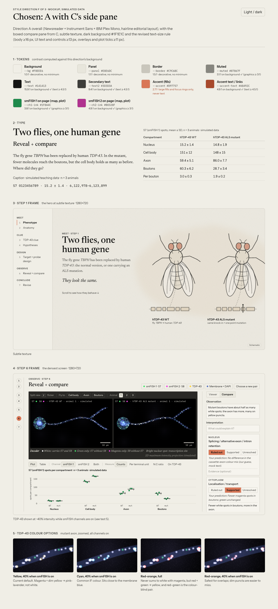
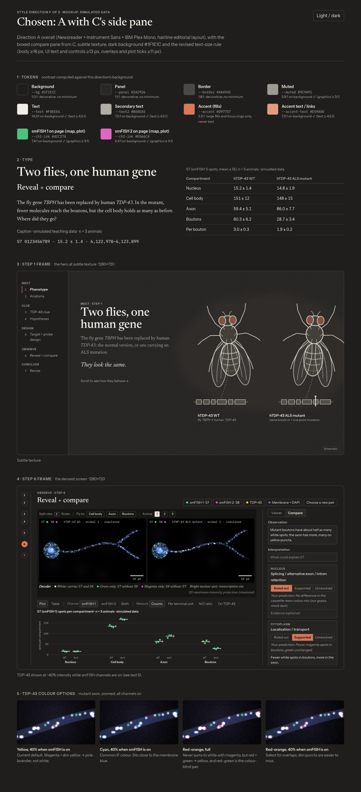
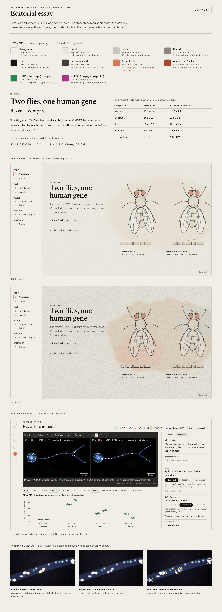
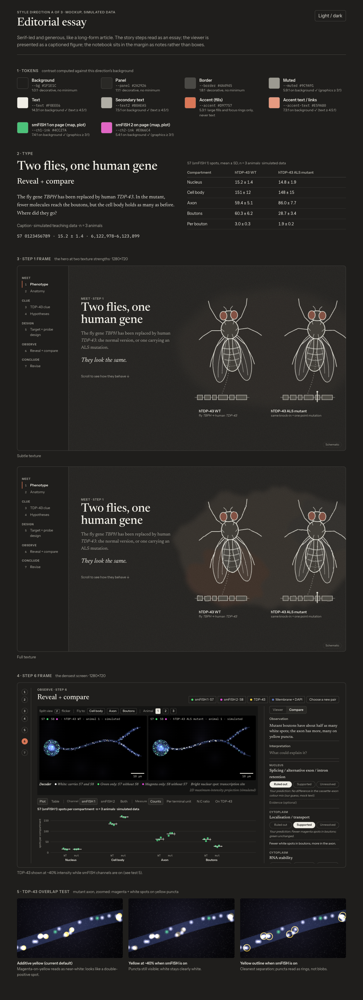
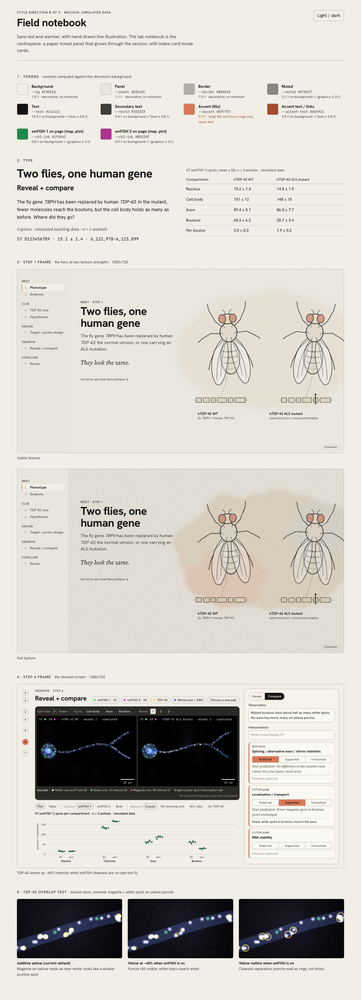
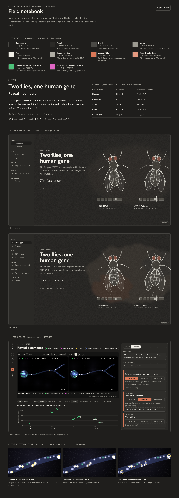
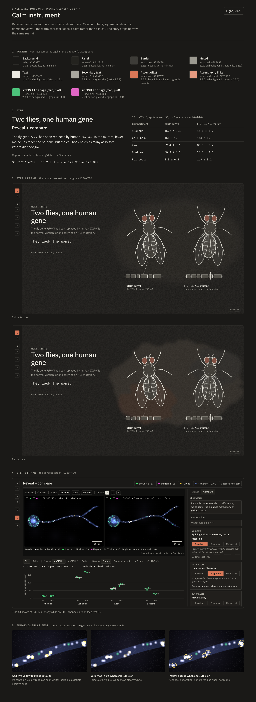
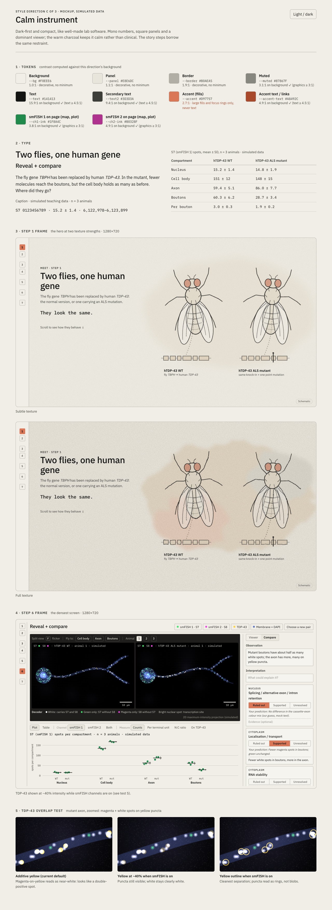

Style-direction phase for [the spec](../spec.md). Mockups only: fake data, no real interactions.

- Pages (open in a browser; light/dark toggle top right): `A-editorial-essay.html`, `B-field-notebook.html`, `C-calm-instrument.html`. They need a local server for fonts and scripts: `python3 -m http.server` in this folder, then `http://localhost:8000/A-editorial-essay.html`.
- Each page shows: 1 tokens with computed contrast · 2 type specimen and count table · 3 step 1 hero at subtle and full texture · 4 step 6 at 1280×720 · 5 TDP-43 overlap test.
- Screenshots are in `screenshots/`: 12 for the three directions (light/dark × 1280/1920 wide) and 2 for the chosen combination (`Chosen-A-with-C-pane.html`, light/dark at 1280).

## Decisions (made)

- [x] **Direction**: A overall, with the compare pane from C → `Chosen-A-with-C-pane.html`
- [x] **Texture strength**: subtle
- [x] **Dark background**: `#1F1E1C`
- [x] **Text-size rule**: body ≥16 px, UI text and controls ≥13 px, overlays and plot ticks ≥11 px
- [ ] **TDP-43 colour**: yellow stays the default for now, dimmed to ~40% while smFISH is on; students can switch LUT (yellow, cyan, red-orange), change brightness and solo channels. Confirm in the pilot.
- Frozen tokens: `tokens.css` (this folder).

## Chosen direction

## Findings from building the mockups

1. **The ≥14 px UI rule doesn't fit step 6 at 1280×720.** Viewer toolbar, legend, chips and plot ticks need about 11.5–13 px. Proposal: body ≥16 px, UI controls ≥13 px, burned-in overlays and plot ticks ≥11 px (mono).
2. **The TDP-43 overlap risk is real** (test 5): additive yellow turns magenta and white spots on puncta into near-white blobs. Dimming to ~40% keeps puncta readable as blobs; an outline gives the cleanest separation. All step 6 frames currently use the dimmed version.
3. **Clay can't carry text.** White on clay is about 3:1, so selected verdict buttons and the current-step marker use near-black text on clay (about 5.9:1).
4. **Whole-neuron view makes spots tiny.** That's expected at the opening zoom; the fly-to buttons and semantic zoom do the work. Worth showing a zoomed-in default for the bouton region in the build.

## Direction A · Editorial essay

## Direction B · Field notebook

## Direction C · Calm instrument

