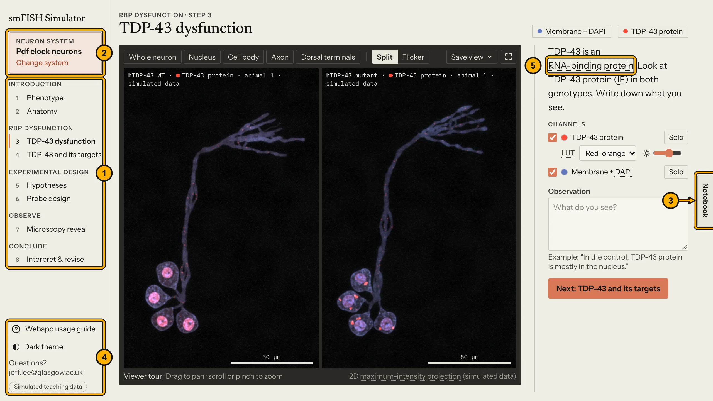
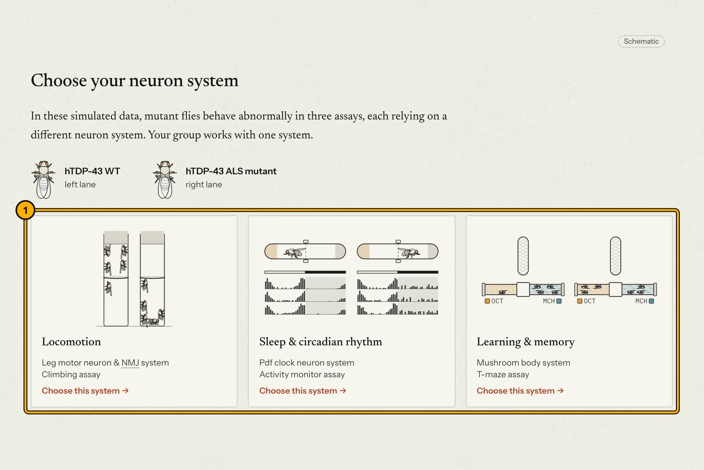
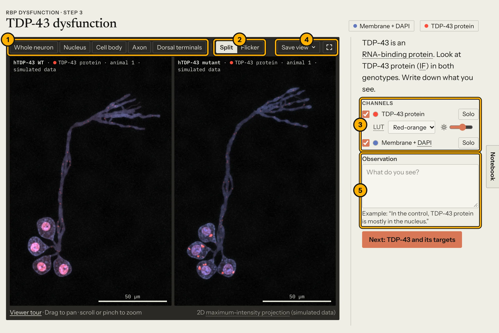
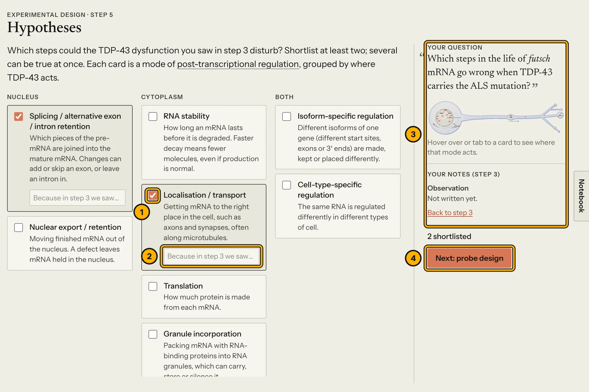
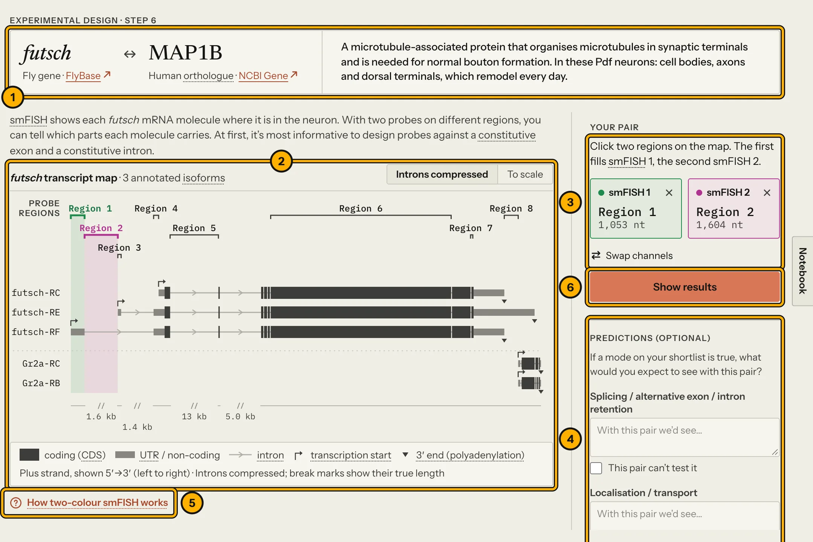
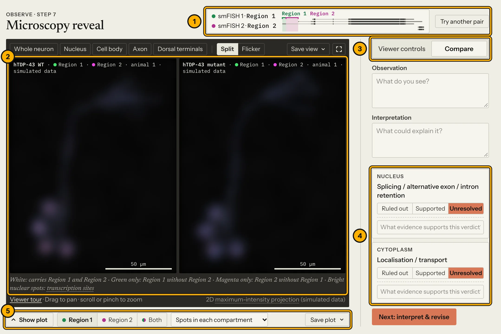
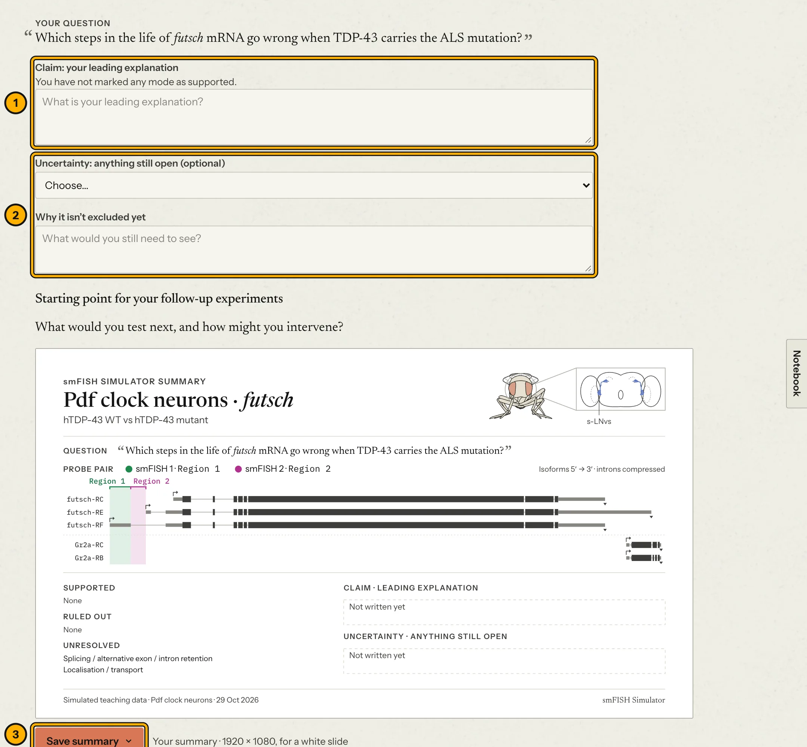

<!--
  The Webapp usage guide, shown at …/guide/ on both servers. Edit this file; preview it in VS Code
  with Cmd+Shift+V. Pictures live in img/: tools/guide-shots.sh retakes the annotated screenshots
  (their numbers match the numbered list under each picture). Students see a change after the
  next release: git push origin main:live.
-->

# Webapp usage guide

The smFISH Simulator is an interactive web app for the *L4 Core Skills in MCB* feedback session. You will design a two-colour single-molecule FISH (smFISH) experiment to investigate how an ALS-linked mutation in TDP-43 disrupts post-transcriptional regulation of a target mRNA in *Drosophila* neurons.

> **Microscopy data in the app are simulated for teaching.** The genes and transcript maps come from FlyBase, but the images, counts and parts of the biology are invented for this exercise. Do not cite them as research findings.

## What you will learn

- Interpret a FlyBase gene model, including alternative isoforms, exons, introns and UTRs.
- Design a two-colour smFISH probe pair that can distinguish between competing hypotheses of post-transcriptional dysregulation.
- Compare smFISH signals and quantitative spot counts across neuronal compartments (nucleus, cell body, axon and synaptic terminals).
- Separate direct observation from interpretation, and evaluate each hypothesis against the evidence.

Your goal is to narrow down the candidate mechanisms, not to solve the case completely. Any question that smFISH alone cannot settle becomes the starting point for your follow-up experiments.

## Open the app

1. On campus (eduroam) or on the university VPN: **[shinytest.mvls.gla.ac.uk/fly-smfish-simulator](https://shinytest.mvls.gla.ac.uk/fly-smfish-simulator/)**
2. Anywhere else, or if the campus link does not load: **[jeffleelab.github.io/fly-smFISH-simulator](https://jeffleelab.github.io/fly-smFISH-simulator/)**

Both links run the same app. Use a laptop with a current version of Chrome, Edge, Firefox or Safari. The interface requires a window of at least 1280 × 720 pixels and is not designed for phones.

**Stay on one link and one browser.** Your notebook is saved locally in that browser for that URL only. Opening the other link, switching browsers or using a private/incognito window starts with an empty notebook (and closing a private window discards your notes). **Notebooks do not sync between computers**, so finish the app on the computer you started on.

## Groups

Groups will be assigned before the session. Each group investigates one *Drosophila* neuronal system: 
 1. **Pdf clock neurons** 
 2. **mushroom body** 
 3. **leg motor neuron & NMJ**

## Finding your way around

1. **Progress rail.** Click any unlocked step to return to it. Locked steps tell you what you need to complete first.
2. **Neuron system.** See your current case here, or click *Change system* to return to the start page.
3. **Notebook.** Collects everything you write across all steps and saves automatically as you type.
4. **Footer controls.** Open this **Webapp usage guide**, toggle the **Dark theme**, or find the instructor's email address.
5. **Dotted underlines.** Click any underlined term for a brief glossary definition.

Help cards appear the first time you open the microscopy viewer; click *Viewer tour* below the image at any time to see them again. Reloading the page preserves your place and your notes.

## Step by step

The screenshots below show the Pdf clock neurons, but all three neuronal systems follow the same workflow. The hypotheses and probe regions shown in the screenshots are arbitrary examples, not hints.

### 1. Phenotype

Watch the introductory sequence, then select your group's assigned neuronal system.

1. Click your assigned system. A short animation illustrates the *Drosophila* behavioural assay used to characterise the mutant phenotype. When it finishes, **Save current view as PNG** copies or downloads the result for your slides; click **Next** to continue.

### 2. Anatomy

Scroll down to zoom from the whole fly into the specific neurons and subcellular compartments you will image.

### 3. TDP-43 dysfunction

Compare TDP-43 immunofluorescence (IF) and subcellular localisation between control (`hTDP-43 WT`, left) and ALS-mutant (`hTDP-43 mutant`, right) neurons, then record what you observe.

1. Use the compartment buttons to jump to a specific neuronal compartment. Scroll or pinch to zoom; drag to pan.
2. **Split** displays control and mutant side by side; **Flicker** alternates them in the same position so you can spot subtle differences.
3. Toggle individual imaging channels on or off, and adjust their lookup table (LUT) colour and brightness.
4. **Save view** copies or downloads the current view as a PNG for your slides. The button beside it opens full-screen mode.
5. Record your observation: describe the localisation pattern you see, keeping it separate from your mechanistic interpretation.

### 4. TDP-43 and its targets

A short animation traces an mRNA through a healthy neuron to illustrate the modes of post-transcriptional regulation (splicing, nuclear export, cytoplasmic stability, axonal transport, granule incorporation and translation) in which TDP-43 normally participates. At the end, it introduces your candidate target gene and the research question your group will investigate.

### 5. Hypotheses

Shortlist which modes of post-transcriptional regulation (referred to in the app as **modes**) could be disrupted for your target mRNA.

1. Tick at least two hypothesis cards. Multiple modes of dysregulation can occur simultaneously.
2. Optional: note your rationale based on the TDP-43 phenotype you observed in Step 3.
3. Your research question and Step 3 notes are shown on the right for reference.
4. Once at least two cards are selected, click **Next: probe design**.

### 6. Probe design

Select two annotated regions of the target gene for your two-colour smFISH probe pair.

1. Gene summary card, with external links to FlyBase and NCBI Gene.
2. The FlyBase transcript map. Click a probe region to assign it to **smFISH 1** (green), and click a second region to assign it to **smFISH 2** (magenta). Toggle *To scale* to view introns at their true genomic proportions.
3. **Your probe pair.** Click **×** to clear a slot, or **Swap channels** to exchange the two fluorophore channels.
4. Optional: note what smFISH signal pattern you would predict under each shortlisted mode.
5. **How two-colour smFISH works**: read this primer first if you are new to smFISH or dual-probe logic.
6. Click **Show results** to run your probe pair.

### 7. Microscopy reveal

Inspect the simulated confocal images and quantitative spot data across compartments, then assign a verdict to each shortlisted mode.

1. Your active probe pair. Click **Try another pair** to return to Step 6; you can test as many probe combinations as you like.
2. Simulated confocal images (blurred in this guide). The legend directly beneath explains how to interpret dual-channel colocalisation (white) versus single-channel spots (green or magenta).
3. Switch between **Viewer controls** (channels and the three biological replicates, `Animal 1–3`) and **Compare** (your notes and hypothesis verdicts).
4. Assign a verdict to each shortlisted mode (*Ruled out*, *Supported* or *Unresolved*) and summarise the evidence. *Unresolved* is a valid verdict when smFISH alone cannot settle a mechanism.
5. Click **Show plot** to view the quantitative SuperPlots across replicates and compartments, and use the dropdown menu to switch metrics. **Save plot** copies or downloads the figure.

Step 8 unlocks once every mode on your shortlist has been given a verdict.

### 8. Interpret & revise

Review the summary of your experiment and formulate your conclusion.

1. **Claim**: state your leading mechanistic explanation for how mutant TDP-43 affects the target mRNA, supported by your smFISH evidence.
2. **Uncertainty** (optional): note anything still open, such as a mode you cannot yet rule out, and explain why.
3. **Save summary** exports a 16:9 overview slide containing your question, probe pair, verdicts, claim and uncertainty. Use this alongside your saved viewer images and plots as the foundation for your presentation.

## Saving your work

- Everything you type in the notebook stays locally in your browser; nothing is uploaded to a server.
- To export figures for your presentation, use the **Save** menu on the Step 1 phenotype, the microscopy viewer, the quantification plot, or the Step 8 summary slide: choose **Copy** to paste directly into PowerPoint, or **Download** to save a PNG file.

## If something goes wrong

- **A step does not load properly.** Force-reload the page without the browser cache: press <kbd>Cmd+Shift+R</kbd> on macOS or <kbd>Ctrl+F5</kbd> on Windows. Your saved notebook entries will be kept.
- **The campus (`shinytest`) link does not load.** Switch to the GitHub Pages backup link at the top of this guide (note that your notebook on the new link will start empty).
- **Anything else:** email [jeff.lee@glasgow.ac.uk](mailto:jeff.lee@glasgow.ac.uk).
